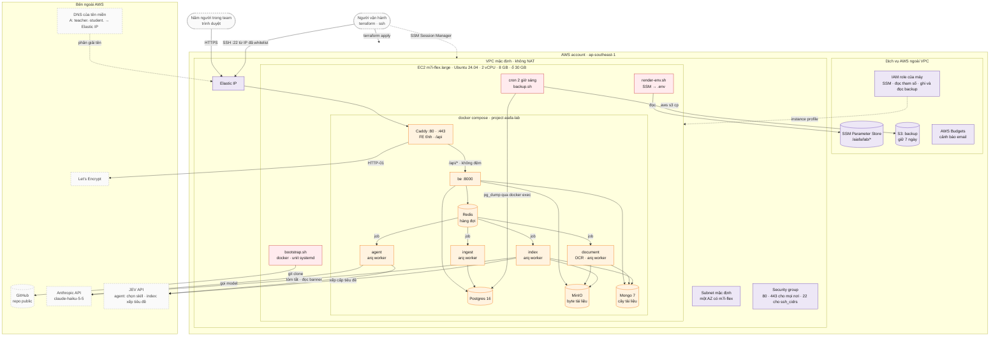
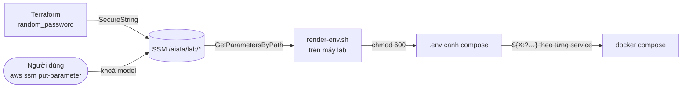
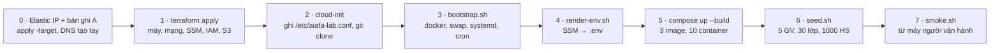

# Kiến trúc lab

> **Trạng thái:** Đã dựng 21/10/2026, đang chạy. Cách vận hành: [Triển khai lab](deploy-lab.md). Lý do
> của các lựa chọn: plan `docs/plans/active/2026-10-20-lab-deploy-aws-plan.md` (D1–D5).

Tài liệu này vẽ **toàn bộ** hạ tầng của lab: thành phần nào tồn tại, nằm ở đâu, ai nói với ai, và
công cụ nào tạo ra từng thứ. Nó là bản đồ; lệnh cụ thể nằm ở `deploy-lab.md`, và hai tài liệu không
được đặt tên khác nhau cho cùng một thứ.

**Lab** là bản chạy thật cho **năm người trong team**, đủ để thử sản phẩm *như nó đang được viết hôm
nay* trên Internet: HTTPS, đăng nhập thật, OCR, model thật, dữ liệu giống thật. Nó **không** phải môi
trường production: một máy, không dự phòng, không migration, dữ liệu seed được phép mất. Mọi thứ nằm
ở `deploy/lab/`.

## Sơ đồ

Câu hỏi sơ đồ trả lời: *lab gồm những gì, nằm ở đâu, ai kết nối tới ai, và công cụ nào tạo ra từng
thứ?*

Đọc sơ đồ:

- **Màu là công cụ tạo ra thành phần:** tím là Terraform, đỏ là script của máy (cloud-init chạy
  `bootstrap.sh`), cam là `docker compose`, xám viền đứt là thứ có sẵn mà lab chỉ dùng. Riêng máy EC2
  do Terraform tạo; khung của nó không tô để các ô bên trong đọc được.
- **Mũi tên nét liền đi từ bên mở kết nối:** `bootstrap → github` vì máy là bên kéo code; `redis →
  agent` vẽ theo chiều job đi, còn về mạng thì worker là bên kéo job từ Redis. **Nét đứt** là cấu hình
  hoặc đường phụ, không phải luồng dữ liệu chính.
- Mọi kết nối ra Internet đi thẳng từ subnet public qua Internet Gateway của VPC mặc định: **không có
  NAT Gateway**, vì máy đã có IP public.
- **Chỉ Caddy mở cổng ra ngoài máy.** Postgres, Redis, MinIO, Mongo và cả `be` chỉ nói trong mạng nội
  bộ của compose; `tools/tests/test_lab_deploy.py` khoá điều đó, và `smoke.sh` kiểm lại từ Internet.

Những gì sơ đồ cố ý giản lược:

| Giản lược | Chi tiết ở |
| --- | --- |
| Mạng compose, volume (`pgdata`, `miniodata`, `mongodata`, `caddy-data`), healthcheck, thứ tự `depends_on` | `deploy/lab/docker-compose.lab.yml` |
| Từng tham số SSM và service nào nhận nó | mục *Bí mật* bên dưới |
| Route table, Internet Gateway, IMDSv2 | `deploy/lab/terraform/main.tf`, `network.tf` |
| Hàng đợi `arq` cụ thể (`aiafa:grading`, `aiafa:document`, …) | `deploy/lab/lab.env` |

## Một lối vào

Câu hỏi mục này trả lời: *vì sao chỉ có Caddy, không load balancer, không ingress?*

Năm người dùng một máy, nên một reverse proxy trên chính máy đó là đủ. Caddy làm ba việc mà nếu tách
ra thì mỗi việc sẽ cần một dịch vụ tính tiền:

| Việc | Caddy làm thế nào | Thay cho |
| --- | --- | --- |
| HTTPS | Tự xin và gia hạn chứng chỉ Let's Encrypt qua HTTP-01 trên cổng 80 | ACM + load balancer |
| FE tĩnh | `file_server` từ `/srv`, ảnh dựng sẵn `dist/` của FE vào image Caddy | S3 + CloudFront |
| Proxy `/api` | `reverse_proxy be:8000` với `flush_interval -1` | Ingress |

FE và `/api` **chung một origin**, như proxy của Vite ở máy dev, nên BE không phải bật CORS và cookie
phiên không phải là cookie bên thứ ba. `index.html` mang `Cache-Control: no-cache` để sau mỗi lần
deploy trình duyệt không giữ bản trỏ vào asset đã xoá; asset có hash trong tên nên cache bao lâu cũng
được.

Không có lớp chặn nào trước site: ai biết URL cũng mở được trang, và cửa duy nhất là đăng nhập của
sản phẩm. Người dùng chọn vậy ngày 24/10/2026, khi bỏ basic auth để tester vào thẳng.

## Hai đường vào máy

| | SSH | SSM Session Manager |
| --- | --- | --- |
| Mở bằng | `ssh -i ~/.ssh/aiafa-lab ubuntu@<ip>` | `aws ssm start-session --target <instance>`, cần Session Manager plugin của aws CLI |
| Ai vào được | Người có khoá riêng **và** đứng ở một IP trong `ssh_cidrs` | Người có quyền IAM trên account |
| Cổng | 22, chỉ mở cho `ssh_cidrs` | Không cổng vào nào; agent của máy gọi ra SSM |
| Khi nào dùng | Hằng ngày: `scp`, sửa nhanh, đọc log | Khi IP nhà mạng đổi, hay khi bỏ `ssh_cidrs` |

`ssh_cidrs` và khoá công khai nằm trong `deploy/lab/terraform/terraform.tfvars`, **gitignore**: repo
public, IP của team không vào git. IP nhà mạng đổi thì sửa biến rồi `terraform apply`; chỉ security
group đổi, máy giữ nguyên. Bỏ trống `ssh_cidrs` thì cổng 22 đóng hẳn.

SSH cũng là đường **duy nhất** tới các kho dữ liệu: `.\dev.ps1 lab-ui` mở một tunnel tới IP container
của Postgres, Redis, MinIO, Mongo (tra lại mỗi lần chạy, vì compose không publish cổng nào của chúng)
và bật bốn UI quản trị **ở máy người vận hành** (`deploy/lab/admin-ui.yml`, chỉ `127.0.0.1`). Máy lab
không chạy UI nào ngoài FE: console có sẵn của MinIO tắt bằng `MINIO_BROWSER=off`
(plan `2026-10-24-lab-admin-ui-plan.md`).

## Bí mật

Câu hỏi mục này trả lời: *bí mật sinh ở đâu, đi qua đâu, và dừng ở service nào?*

| Tham số | Ai sinh | Service nhận |
| --- | --- | --- |
| `POSTGRES_PASSWORD` | Terraform | `postgres`, và `be`, `ingest` qua `DATABASE_URL` |
| `MINIO_SECRET_KEY` | Terraform | `minio`, `be`, `document`, `index` |
| `MONGO_PASSWORD` | Terraform | `mongo`, và `be`, `document`, `index` qua `MONGO_URL` |
| `LAB_ACCOUNT_PASSWORD` | Terraform | Chỉ `seed.sh`, qua stdin của `python -m be.lab_seed` |
| `CLAUDE_API_KEY`, `JEV_API_KEY`, `OPENAI_API_KEY` (tuỳ chọn) | **Người dùng tự thêm** | `agent`, `document`, `index`. **Không** `be` |
| `SITE_ADDRESS` | Terraform (String) | `caddy` |

Ba nguyên tắc:

- **Khoá model không bao giờ đi qua Terraform**, nên không nằm trong state. Terraform chỉ quản mật khẩu
  nó tự sinh.
- **Mỗi service chỉ cầm bí mật của mình**, đúng như ranh giới giữa các service ở máy dev: `agent` không
  có `DATABASE_URL`, `be` không có khoá model. `lab.env` (không bí mật, nằm trong git) không chứa mật
  khẩu nào.
- Thiếu `CLAUDE_API_KEY` thì `render-env.sh` ghi `LLM_ENABLED=false` vào `.env.overrides`: lab vẫn
  chạy, Kriky trả nội dung dựng sẵn.

Máy đọc SSM bằng **instance profile**, không có khoá AWS nào trên đĩa. Role gắn
`AmazonSSMManagedInstanceCore` để Session Manager chạy được, và policy ấy tự nó cho `ssm:GetParameter`
trên **mọi** tham số của account: giới hạn theo tiền tố `/aiafa/lab` trong `iam.tf` chỉ thật sự có tác
dụng với `GetParametersByPath`. Chấp nhận được vì account chỉ dùng cho lab; dùng chung với việc khác
thì phải thay policy ấy. IMDSv2 bắt buộc, với
`http_put_response_hop_limit = 1`: process trên máy gọi được IMDS, container trên docker bridge thì
không. Không có giới hạn này, `document` — thứ parse PDF do người lạ tải lên — lấy được credential của
role.

## Tên miền và chứng chỉ

Mỗi vai một tên: giáo viên `teacher.<base_domain>`, học sinh `student.<base_domain>`. Terraform dựng
hai tên từ biến `base_domain` và ghi cả hai vào tham số SSM `SITE_ADDRESS` (`teacher.…, student.…`).
Caddy nhận cả hai trong **một** khối site: cùng FE tĩnh, cùng `/api`, mỗi tên một
chứng chỉ. BE không biết tên miền nào: FE và `/api` cùng một origin, cookie chỉ gắn theo host, nên mỗi
tên giữ phiên của riêng nó.

FE là một bản build phục vụ cả hai tên, nên nó nhận ra vai qua `location.hostname` (`surfaceFor` ở
`services/fe/src/App.tsx`): trên hai tên lab, **tên máy thắng hash**. Caddy không làm được việc này
vì trình duyệt không gửi hash lên server. Hai tiền tố `teacher.` / `student.` vì vậy là một quy ước
giữa Terraform và FE; `tools/tests/test_lab_deploy.py` đòi chúng khớp nhau. Ở mọi tên khác (máy dev,
stack lab ở local) FE chọn vai theo hash như trước.

Tách tên là **giao diện, không phải ranh giới quyền.** Hai tên dùng chung một BE; BE không kiểm
Host. Ai cũng gõ được `teacher.…`, và một cookie giáo viên dùng được ở cả hai tên.
Quyền vẫn ở BE: mỗi vai một cookie phiên, cấp sau khi đúng mật khẩu.

`base_domain` nằm trong `terraform.tfvars` và không có giá trị mặc định. Hai bản ghi A trỏ về
Elastic IP, do người quản DNS của tên miền tạo tay: Terraform không quản bản ghi ấy, để `destroy` lab
không đụng vào một zone có thể dùng chung với dự án khác. Vì vậy lần đầu apply làm hai bước: xin
Elastic IP (`-target=aws_eip.lab`), tạo bản ghi, rồi mới dựng máy.

Let's Encrypt cấp chứng chỉ qua HTTP-01, nên tên phải phân giải về máy **trước** khi Caddy xin, không
có bản ghi AAAA trỏ đi nơi khác (Let's Encrypt thử IPv6 trước), và CAA của zone, nếu có, phải cho phép
`letsencrypt.org`. Giới hạn tần suất của Let's Encrypt tính theo tên miền gốc, nên dùng chung với mọi
tên con khác của zone. Elastic IP giữ nguyên qua stop/start máy; destroy rồi apply lại là đổi IP, phải
sửa bản ghi A. Đổi tên miền thì người dùng đăng nhập lại: cookie và `localStorage` gắn theo host.

## Lộ trình dựng

Câu hỏi sơ đồ trả lời: *từ `terraform apply` tới một URL dùng được, chuyện gì xảy ra theo thứ tự nào?*

| Bước | Làm gì | Công cụ | Ở đâu |
| --- | --- | --- | --- |
| 0 | Xin Elastic IP (`terraform apply -target=aws_eip.lab`); tạo hai bản ghi A `teacher`, `student` → IP ấy, chờ phân giải được | Terraform; DNS của tên miền, tạo tay | máy người vận hành |
| 1 | VPC mặc định + subnet mặc định, security group, Elastic IP, key pair, EC2, IAM role, bốn mật khẩu SSM, bucket backup, budget | Terraform, người vận hành chạy | `deploy/lab/terraform/` |
| 2 | Ghi cấu hình không bí mật (thư mục, nhánh, region, bucket), cài git, clone nhánh `main` | cloud-init, `user_data.sh.tftpl` | máy lab |
| 3 | Cài docker, compose, aws CLI; bật 2 GB swap; cài unit systemd và cron **trước** khi dựng | `bootstrap.sh` | máy lab |
| 4 | Dựng `.env` từ SSM | `render-env.sh` | máy lab |
| 5 | Dựng image `app`, `document`, `caddy`; bật stack; chờ `be` healthy | `docker compose` | máy lab |
| 6 | Seed dữ liệu lab, **một lần** (dấu `/var/lib/aiafa-lab/seeded`) | `seed.sh` | máy lab |
| 7 | Kiểm trang chủ, đăng ký tắt, `X-Actor` vô hiệu, cookie `Secure`, HTTP → HTTPS, cổng nội bộ đóng | `smoke.sh` | máy người vận hành |

Lần đầu mất **15–25 phút**, phần lớn ở bước 5: image `document` tải torch CPU và model OCR. Bootstrap
chạy lại an toàn; hỏng ở bước nào thì sửa rồi chạy lại cả script.

Sau reboot, unit `aiafa-lab.service` lặp lại bước 4 và `compose up -d` (không dựng lại image). Bản mới
lên bằng `deploy.sh <tag>`: chỉ nhận tag `lab-*` (đặt bằng `.\dev.ps1 release`), `git fetch` tag ấy,
ghi tên bản vào `deploy/lab/.env.version`, bước 4, `compose up -d --build --remove-orphans`,
rồi dọn image và build cache cũ, vì mỗi lần dựng lại image `document` để lại vài GB trên ổ 30 GB.

## Hợp đồng giữa các bước

Mỗi bước chỉ dùng thứ bước trước **giao**, không với vào bên trong nó.

| Bước giao | Giao cái gì | Ràng buộc bắt buộc |
| --- | --- | --- |
| 0 → 5 | `teacher.…` và `student.…` phân giải về Elastic IP | Caddy xin chứng chỉ ngay khi bật ở bước 5; tên chưa phân giải là Let's Encrypt từ chối, hỏng nhiều lần là chạm giới hạn tần suất |
| 1 → 2 | Máy có instance profile; mọi tham số SSM do Terraform quản đã tồn tại | `aws_instance` `depends_on` các tham số SSM và policy IAM: bootstrap đọc SSM ngay ở lần khởi động đầu |
| 2 → 3 | `/etc/aiafa-lab.conf` và repo ở `/opt/aiafa` | Nhánh được clone phải có `deploy/lab/`; repo phải public vì máy clone không kèm khoá |
| 3 → 4 | docker, aws CLI ở `/snap/bin` | cron và systemd không có `/snap/bin` trong PATH: `lib.sh` tự thêm |
| 4 → 5 | `deploy/lab/.env` (chmod 600), có thể kèm `.env.overrides` | Ba mật khẩu hạ tầng và `SITE_ADDRESS` dùng `${X:?…}`: thiếu một biến là compose dừng ngay, không bật một service cầm mật khẩu rỗng. Khoá model được phép rỗng (`${X:-}`) |
| 5 → 6 | `be` healthy | Bootstrap seed **một lần** nhờ dấu `/var/lib/aiafa-lab/seeded`. `seed.sh` luôn gọi `--reset`: gọi tay là xoá sạch dữ liệu lab |
| Trong 5 | Ba image | **Mỗi image chỉ một service dựng** (`be`, `document`, `caddy`); service còn lại dùng lại image với `pull_policy: never`. Hai service cùng `build` một tag thì buildx dựng song song và báo `already exists` |

## Ràng buộc từ ứng dụng mà hạ tầng phải giữ

Các ràng buộc dưới đây đến từ code của các service, không từ hạ tầng.

| Ràng buộc | Nguồn | Tác động lên hạ tầng |
| --- | --- | --- |
| Chat của giáo viên stream bằng SSE | `be`: `teacher_chat` | Caddy `flush_interval -1`: proxy đệm thì trình duyệt nhận cả lượt một lần |
| `X-Actor` là danh tính của máy dev | `be`: `DEV_IDENTITY_ENABLED` | Lab đặt `false`; `smoke.sh` kiểm route giáo viên trả 401 khi chỉ có `X-Actor` |
| Đăng ký giáo viên mở mặc định | `be`: `TEACHER_SIGN_UP_ENABLED`, ADR-36 (hậu ký 20/10/2026) | Lab đặt `false`, BE trả 403; FE hiện lời từ chối của BE (D1) |
| Cookie phiên cần cờ `Secure` trên HTTPS | `be`: `SESSION_COOKIE_SECURE` | Lab đặt `true`; stack lab chạy local (`local-env.sh`, HTTP ở `127.0.0.1:8088`) tắt qua `.env.overrides` |
| OCR (torch, paddle, easyocr) cần RAM và CPU | `services/document` | 8 GB RAM, 2 GB swap cho lúc dựng image; `OCR_THREADS=2` theo 2 vCPU. Đo được: khoảng 2 GB RAM cả stack lúc rảnh, 5 giây/trang scan |
| `document` parse tệp do người dùng tải lên | `services/document` | IMDS hop limit 1 (mục *Bí mật*) |
| **Không có migration**: BE đối chiếu schema lúc khởi động và từ chối chạy khi lệch | `packages/schema`: `schema.ddl.check_schema`, gọi ở `be/main.py` | Đổi model database thì `seed.sh`, mất dữ liệu lab (D5) |
| AGENT không được chạm database | `AGENTS.md`, `tools/check_contract.py` | Compose không đưa `DATABASE_URL` cho `agent` |
| Hàng đợi `arq` dùng chung một Redis | `lab.env` | Redis không lưu đĩa (`--save ""`): mất job đang chờ khi khởi động lại là chấp nhận được |

## Quyết định đã chốt

| Câu hỏi | Chốt | Hệ quả |
| --- | --- | --- |
| Công cụ hạ tầng | **Terraform**, state local, gitignore (20/10/2026) | Một người vận hành giữ state; state chứa mật khẩu do `random_password` sinh |
| Đóng gói | **Một EC2, một `docker compose`** | Không cluster, không dự phòng; máy chết là lab chết, dựng lại bằng `apply` và backup |
| Loại máy | **`m7i-flex.large`**: đã kiểm thuộc free tier của account ở Singapore | Free plan đổi danh sách thì đổi `instance_type` |
| Mạng | **VPC mặc định, không NAT** | Account mới có thể có VPC mặc định mà không có subnet: Terraform tạo subnet mặc định bằng `aws_default_subnet` (gặp thật lúc apply 21/10/2026) |
| Reverse proxy | **Caddy** (20/10/2026) | Một lối vào làm cả HTTPS, FE tĩnh, proxy |
| Tên miền | **Mỗi vai một subdomain của `base_domain`** (22/10/2026) | Bản ghi A tạo tay, Terraform không quản DNS; FE chọn vai theo tiền tố tên máy; đổi Elastic IP là sửa bản ghi |
| OCR | **Có** (20/10/2026) | Image `document` riêng (D3), máy 8 GB |
| Đăng ký giáo viên | **Tắt, chặn ở BE** (D1) | FE không đổi |
| Tài khoản seed | **Một mật khẩu chung** cho giáo viên và học sinh (D4) | Biết URL, biết SĐT seed và mật khẩu ấy là vào được mọi tài khoản |
| Basic auth | **Không có** (24/10/2026; trước đó có, từ 20/10) | Ai biết URL cũng tới được màn đăng nhập; bảo mật để sau |
| Khoá model | **Người dùng tự thêm vào SSM** | Không qua Terraform, không vào state |
| Vào máy | **SSH theo IP whitelist + SSM** (21/10/2026) | IP và khoá công khai trong `terraform.tfvars` gitignore |
| Migration | **Không có** (D5) | Xem lại ngày lab có dữ liệu thật |
| Code trên máy | **Clone nhánh `main` của repo public** | Lần dựng đầu 21/10/2026 đưa code chưa push lên bằng `git archive` + `scp`. Từ bản `lab-2026.0.1`, `deploy.sh` chỉ nhận một tag `lab-*` đã push |

## Quyết định còn mở

| Câu hỏi | Vì sao chưa chốt |
| --- | --- |
| Dòng `deploy/` trong bảng layout của `AGENTS.md` | File ấy đang đúng trần 184 dòng; thêm là sửa contract (D2) |
| Bật AWS Budgets | Cần email nhận cảnh báo trong `terraform.tfvars` |

## Ngoài phạm vi

Monitoring và cảnh báo của ứng dụng (chỉ có AWS Budgets cho tiền), log tập trung (đọc bằng `docker
compose logs` trên máy), CI/CD (deploy bằng tay qua `deploy.sh`), dự phòng và tự phục hồi ngoài
`restart: unless-stopped`, migration, quản bản ghi DNS bằng Terraform. Một môi trường cho trường thật
sẽ cần ít nhất: migration, database có backup theo thời điểm (RDS), tên miền và chứng chỉ của trường,
mật khẩu riêng cho từng tài khoản, và log tập trung.

## Hiện trạng (24/10/2026)

- 23 tài nguyên (có khoá SSH, chưa có budget); máy chạy đủ 10 container; seed đã chạy.
- Chạy trên `teacher.recruitai.io.vn` và `student.recruitai.io.vn` (từ 24/10/2026), chứng chỉ Let's
  Encrypt cho cả hai; DNS của `recruitai.io.vn` ở Vinahost. Không còn basic auth.
- Khoá Claude và JEV đã có trong SSM; model bật.
- `smoke.sh` qua trên cả hai tên từ Internet (24/10/2026). Đã thử tay trên trình duyệt: chọn vai theo
  tên máy, phiên giáo viên và học sinh song song ở hai tab; trước đó (21/10/2026) cả phía giáo viên
  (bảng theo dõi, đề, lớp, kết quả, báo cáo, tài liệu và OCR, soạn đề với model thật, duyệt, phát
  hành, hoàn tác) lẫn phía học sinh (làm bài, trợ lý, vòng chữa).
- Bản 24/10/2026 thêm cột `bank_questions.edited_at`; database lab đã `ALTER` tay, giữ dữ liệu.
- Code trên máy là bản đẩy lên bằng `git archive`, chưa phải một bản clone của `main`. **Phải push
  các commit của lab lên `main`** thì `deploy.sh` mới dùng được.
