# Thiết kế AGENT

## Mục đích tài liệu

Tài liệu này dành cho người sắp đọc hoặc sửa `services/agent`. Nó trả lời: AGENT nhận việc từ đâu,
mỗi việc chạy qua graph nào, model được gọi ra sao, và sau mỗi lời model những luật nào sửa hay trả
lại lời ấy.

Ba thứ tài liệu này **không** nói, vì đã có chỗ khác nói:

- vì sao AGENT là một service riêng, không giữ credential database, và không quyết định gì:
  [Architecture](architecture.md), mục *Ranh giới quyền quyết định*; ràng buộc cho người sửa code ở
  `services/agent/AGENTS.md`;
- luật nghiệp vụ mà prompt và luật code phục vụ: các ADR trong [`docs/decisions/`](../decisions/README.md);
- giao diện chat giáo viên hiện những gì AGENT trả về: [Teacher Surface](teacher-surface.md).

Code nằm ở `services/agent/src/agent/`. Mỗi sơ đồ dưới đây ghi tên hàm thật, nên tìm trong code
được ngay.

Ba chữ hay gặp:

- **`known`**: ghi chú model tự viết trong mỗi đề nghị, liệt kê những gì nó đã biết (môn, khối,
  phạm vi, số câu). Không tới tay giáo viên; luật code đọc nó để bắt dàn ý lệch số câu hay câu hỏi
  lại thừa.
- **Lượt kể lại**: sau khi BE chạy xong một plan, nó hỏi AGENT thêm một lượt để Kriky kể lại kết quả
  (ADR-25). Lượt này chỉ có tool đọc, `plannable` rỗng.
- **Chip**: tài liệu giáo viên đính kèm vào câu chat (`attached_document`).

## AGENT đứng ở đâu

Câu hỏi sơ đồ trả lời: *việc tới AGENT bằng đường nào, kết quả đi về đâu, và AGENT gọi ra những gì?*

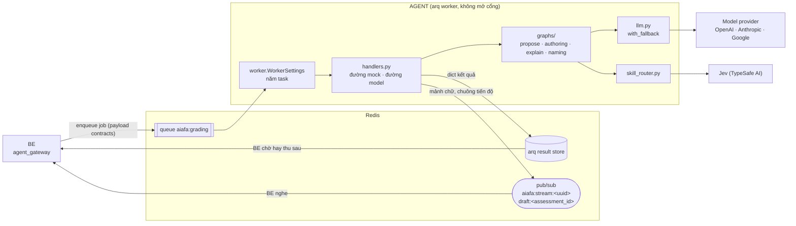

Ba điều sơ đồ cho thấy:

- **Đường vào duy nhất là queue.** AGENT không mở cổng nào, và mọi thứ một job cần đi trong payload
  của nó (`packages/contracts`). AGENT không đọc database nào; `tools/check_contract.py` đỏ nếu một
  credential database xuất hiện ở đây.
- **Kết quả là một `dict`, không phải phán quyết.** BE kiểm lại mọi thứ rồi mới ghi.
  `tests/test_no_routing_decision.py` gọi mọi task và đỏ nếu kết quả mang một trường phán xử.
- **Chỉ `llm.py` dựng model,** nên đổi provider là sửa `.env`, không sửa graph nào. Chỉ
  `skill_router.py` import SDK của Jev.

## Năm task

Câu hỏi sơ đồ trả lời: *task nào chạy handler nào, và handler ấy đi qua graph nào?*

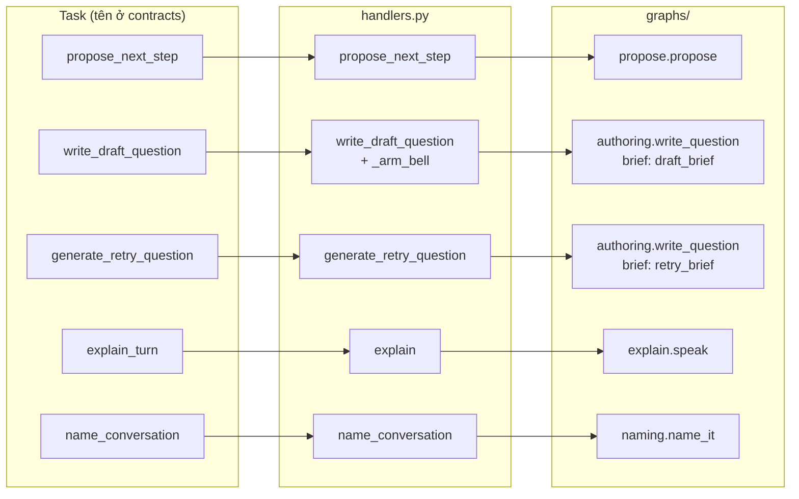

Worker đăng ký task dưới hằng số của `contracts`, không dưới tên hàm Python. Đổi tên một hàm không
làm gãy lời gọi enqueue của BE. Khi nào BE gọi từng task, và nó làm gì với kết quả, xem
[Architecture](architecture.md), bảng ở mục *Đường giao tiếp*.

**Graph là nơi duy nhất gọi model;** handler không chạm `llm`. Vì thế cả `naming` cũng là một graph,
dù nó chỉ có một node.

## Model tắt, model hỏng

Mỗi handler có hai đường:

- **`LLM_ENABLED=false`** (hay `LLM_MODEL` trống): trả nội dung dọn trước, tất định. Luồng chạy được
  đầu tới cuối mà không tốn tiền, và test khẳng định được cùng một điều hai lần.
- **Model bật:** gọi graph.

Model bật mà hỏng thì mỗi task xử một kiểu, theo cái giá của chữ sai ở task ấy:

| Task | Model hỏng thì | Vì sao |
| --- | --- | --- |
| `propose_next_step` | Trả một **thông báo hệ thống** (`notice=True`, *"Kriky chưa trả lời được lúc này…"*), không lùi về mock | Mock đoán việc bằng từ khoá, và chữ của nó sẽ nói dưới giọng Kriky (ADR-30) |
| `write_draft_question` | **Ném lỗi**; job hỏng | Câu dọn trước từng lọt vào đề thật. BE ghi `last_fault` rồi hỏi lại có trần |
| `generate_retry_question` | Lùi về kho biến thể của câu gốc; kho trống thì ném | BE trả 503 trước khi ghi lượt, nên học sinh không mất vòng nào (ADR-17) |
| `explain_turn` | Chưa phát mảnh nào thì trả lượt dọn trước; đã phát thì giữ đúng phần đã phát | Chữ đã lên màn hình học sinh, nên phải lưu đúng thứ ấy |
| `name_conversation` | Trả tên dọn trước | Tên đoạn chat không vào đề nào |

## `llm`: provider và fallback

Câu hỏi sơ đồ trả lời: *một graph xin model thế nào, và model dự phòng chen vào ở đâu?*

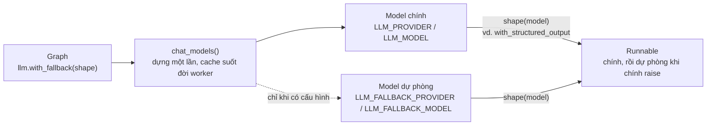

Hai chỗ dễ sai, cả hai ghi ở docstring của `llm.py`:

- **Credential được truyền vào** từ `Settings`, không đọc từ biến môi trường của process.
- **`shape` áp lên từng model trước**, rồi mới xâu fallback. Ngược thứ tự thì
  `with_structured_output` đi qua reflection trên type hint và sụp bằng một `NameError` khó đọc.

Có một model thì `with_fallback` trả thẳng runnable của nó, không bọc, nên stream giữ nguyên.

## Chọn skill (Jev)

Câu hỏi sơ đồ trả lời: *lời dặn nào của Kriky được nạp cho lượt này?*

Một **skill** là một file Markdown trong `agent/skills/`. Frontmatter của nó có `name` và
`description` tiếng Anh, chính là `criteria` Jev đọc. Thân file là lời dặn tiếng Việt chèn vào
prompt. Hiện có bốn skill:

- `soan-de`: soạn đề;
- `lop-va-ket-qua`: tra lớp, kết quả, tạo lớp;
- `hoi-tai-lieu`: hỏi nội dung sách;
- `tro-chuyen-chung`: skill bao quát, không bao giờ được hỏi.

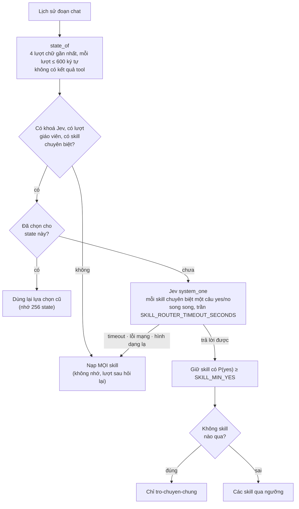

**Luật an toàn không bao giờ nằm trong skill.** Jev chọn sai thì một skill vắng mặt, nên mọi luật mà
vắng nó là nguy hiểm thuộc về `CORE` của `graphs/propose/prompt.py`.

Việc chọn skill còn bật hai luật code:
- `books.opens_library` chỉ mở thư viện tài liệu ở lượt có `soan-de` hay `hoi-tai-lieu`;
- `read_order.answered_unread` chỉ trả lại lời trả lời về sách ở lượt có `hoi-tai-lieu`.

Ở lượt kể lại sau một plan, `propose` cộng thêm skill của chính plan
ấy (`telling_skills`), vì lời cuối có thể là lời mở của plan chứ không phải lời giáo viên.

## Graph `propose`: một bước của lượt chat giáo viên

`propose_next_step` là task phức tạp nhất. Nó không hoàn thành việc gì của riêng nó. BE sở hữu vòng
lặp của một lượt chat, và **mỗi bước** của vòng ấy hỏi AGENT *"làm gì tiếp"* một lần. AGENT trả một
trong năm `kind`:

| `kind` | Nghĩa | BE làm gì |
| --- | --- | --- |
| `say` | Nói một câu | Lưu, kết thúc lượt |
| `ask_clarify` | Hỏi lại, kèm nút (tối đa 3 câu, ADR-32) | Lưu, chờ giáo viên |
| `call_tool` | Gọi một tool **đọc** ngay | Chạy tool, thêm kết quả vào lịch sử, hỏi AGENT bước kế |
| `outline` | Nêu dàn ý đề (ADR-29, ADR-38) | Kiểm số câu và bài nguồn, lưu, chờ giáo viên đồng ý |
| `plan` | Nêu các việc **ghi** cho pha 2 | Kiểm cả plan, chạy từng bước, rồi hỏi AGENT một lượt kể lại |

### Một bước, đầu tới cuối

Câu hỏi sơ đồ trả lời: *một job `propose_next_step` đi qua những gì, theo thứ tự nào?*

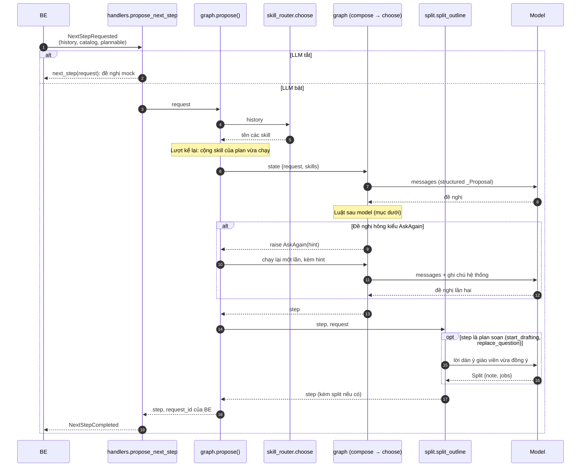

Handler chỉ gọi `propose()` và bắt lỗi: provider hỏng ở bất kỳ đâu trong `propose()` thì handler trả
thông báo hệ thống (mục *Model tắt, model hỏng*). Phía BE của vòng này, gồm pha 1 hỏi AGENT, pha 2 chạy plan và chuông
soạn đề, được vẽ ở [Architecture](architecture.md#một-lượt-chat-giáo-viên).

### Prompt được dựng thế nào

Câu hỏi sơ đồ trả lời: *model thấy gì, theo thứ tự nào?* (`propose/compose.py`)

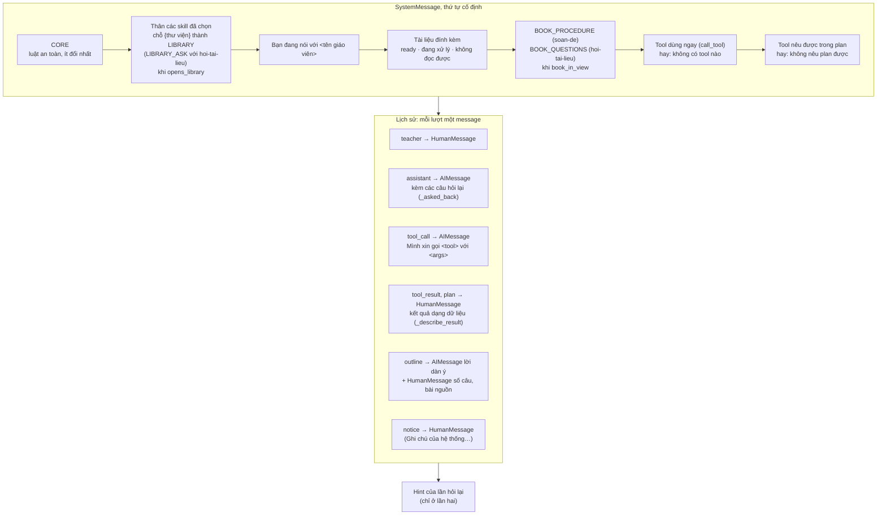

Thứ tự trong `SystemMessage` có lý do. Phần đứng đầu càng ít đổi giữa hai lượt thì prompt cache của
provider càng dùng lại được nhiều. Skill đứng **sau** `CORE`, nên không skill nào nói trước được một
luật an toàn.

`catalog` và `plannable` tới thành hai danh sách riêng. Model phải phân biệt *gọi được ngay* với
*hẹn làm ở pha 2*; gọi một tool ghi ngay lượt này thì BE từ chối, và vòng lặp mất một bước chỉ để
phát hiện lại đúng điều ấy.

### Luật sau model, theo đúng thứ tự

Câu hỏi sơ đồ trả lời: *sau khi model trả lời, `choose()` làm gì với đề nghị, theo thứ tự nào?*

Có hai loại luật. **Luật sửa** đổi đề nghị thành một đề nghị khác, thường là một lời gọi tool đọc mà
model bỏ qua. **Luật trả lại** ném `AskAgain`, để `propose` hỏi model thêm đúng một lần.

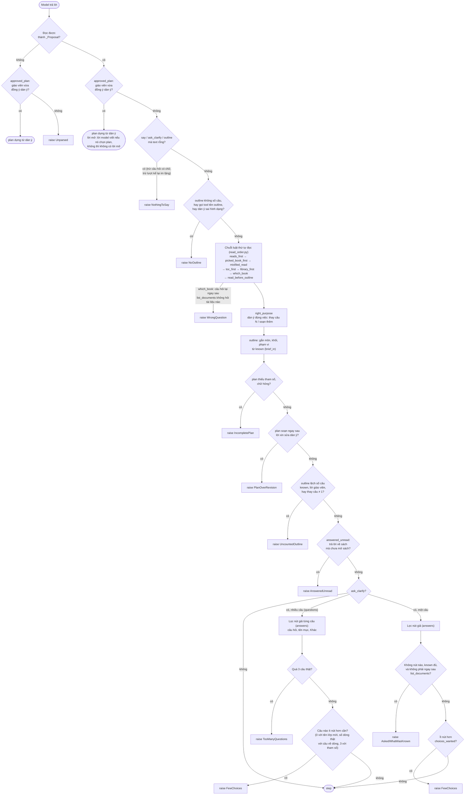

Hai chỗ sơ đồ không vẽ: đề nghị không chuyển được thành `NextStepCompleted` (`ValidationError`) thì
với `outline` là `NoOutline`, với kind khác là lỗi ném thẳng, không hỏi lại, và handler ra thông báo
hệ thống.

`approved_plan` đứng **trước** mọi luật trả lại. Nếu sau lời *"oke"* model trả về một câu rỗng hay
hỏng mà luật biến nó thành câu hỏi lại, thì lời duyệt mất, và lần gõ lại không còn đứng ngay sau dàn
ý (ADR-29).

Luật thứ tự đọc là luật sửa, trừ `which_book` ném `WrongQuestion`. Đề nghị đúng việc mà sai bước thì thành một lời gọi tool đọc; ở
bước kế của vòng BE, model nêu lại với kết quả trong tay. Mỗi luật tự kiểm xem bước đọc đã có chưa,
nên không gọi lại một bước đã đọc.

### Hỏi lại đúng một lần

Câu hỏi sơ đồ trả lời: *một `AskAgain` thì kết thúc bằng gì?* (`propose/graph.py`)

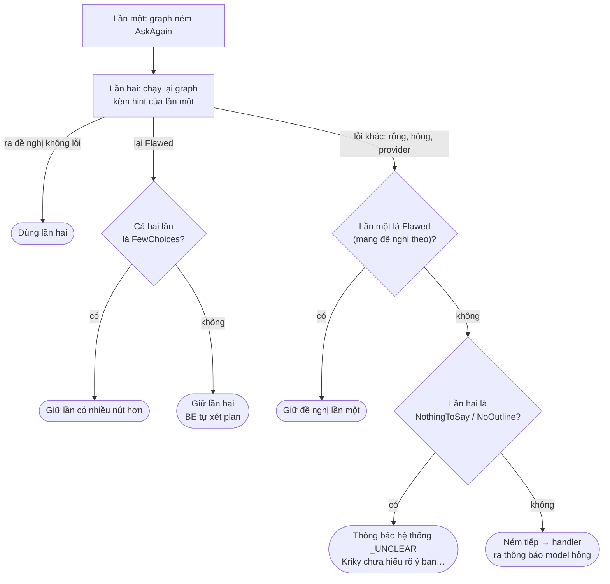

Luật chung của lưới này: **hỏi lại không bao giờ được làm kết quả tệ hơn lúc chưa có nó.** Một
`Flawed` là đề nghị dùng được nhưng thiếu một thứ, nên nó mang chính đề nghị ấy theo. Lần hai hỏng
kiểu khác thì vẫn còn lần một để dùng.

| Lớp (`ask_again.py`) | Bắn khi | Mang đề nghị theo |
| --- | --- | --- |
| `NothingToSay` | `say`, `ask_clarify`, `outline` mà lời rỗng | không |
| `Unparsed` | Đầu ra không đọc được thành đề nghị (vd. tên tool ghi vào `kind`) | không |
| `NoOutline` | Dàn ý không số câu, sai hình dạng, hay gọi `outline` như một tool | không |
| `IncompletePlan` | Bước plan thiếu tham số bắt buộc, hay chữ hỏng | có |
| `PlanOverRevision` | Plan soạn ngay sau lời giáo viên xin sửa dàn ý | có |
| `UncountedOutline` | Số câu dàn ý khác `known`, khác lời giáo viên, hay thay câu mà khác 1; hint nói đúng số | có |
| `AnsweredUnread` | Trả lời câu hỏi về sách mà chưa mở sách | có |
| `AskedWhatWasKnown` | Hỏi lại không câu, không nút, dù `known` đã đủ bốn mục | có |
| `TooManyQuestions` | Quá 3 câu hỏi một lượt (ADR-32) | có |
| `FewChoices` | Ít nút thật hơn cần (3 cho tham số, số dòng có thật cho câu về dòng, 0 cho câu xin tên lớp mới) | có |
| `WrongQuestion` | Câu hỏi lại ngay sau `list_documents` mà không hỏi *tài liệu nào* | có |

### Dàn ý, đồng ý, chia việc (ADR-29, ADR-38)

Câu hỏi sơ đồ trả lời: *một đề đi từ lời xin tới các câu được soạn qua những lượt nào?*

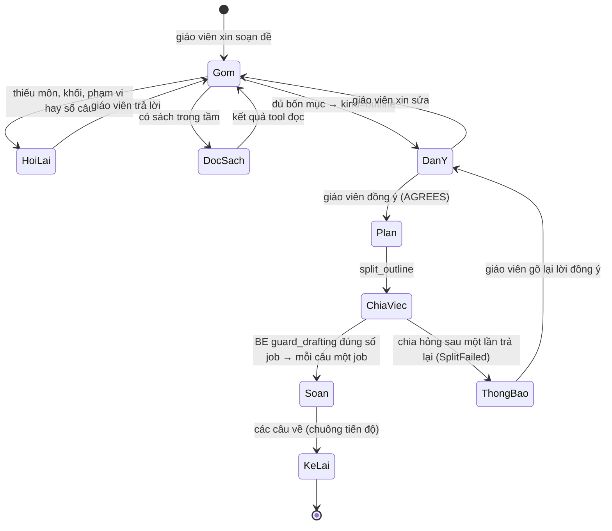

- **Dàn ý** là lời Markdown Kriky viết, kèm `outline_questions` (số câu) và `outline_nodes` (bài
  nguồn). BE chỉ kiểm hai thứ ấy, không đọc lời.
- **Đồng ý** được đọc bằng regex (`outline.AGREES`). `approved_plan` dựng plan từ chính lượt dàn ý:
  việc (`for`: `new`, `more`, `replace`), câu bị thay, môn, khối, phạm vi. Model không phải nhớ lại.
- **Chia việc** chạy ở cuối `propose()`, trong cùng job, sau khi plan đã có:

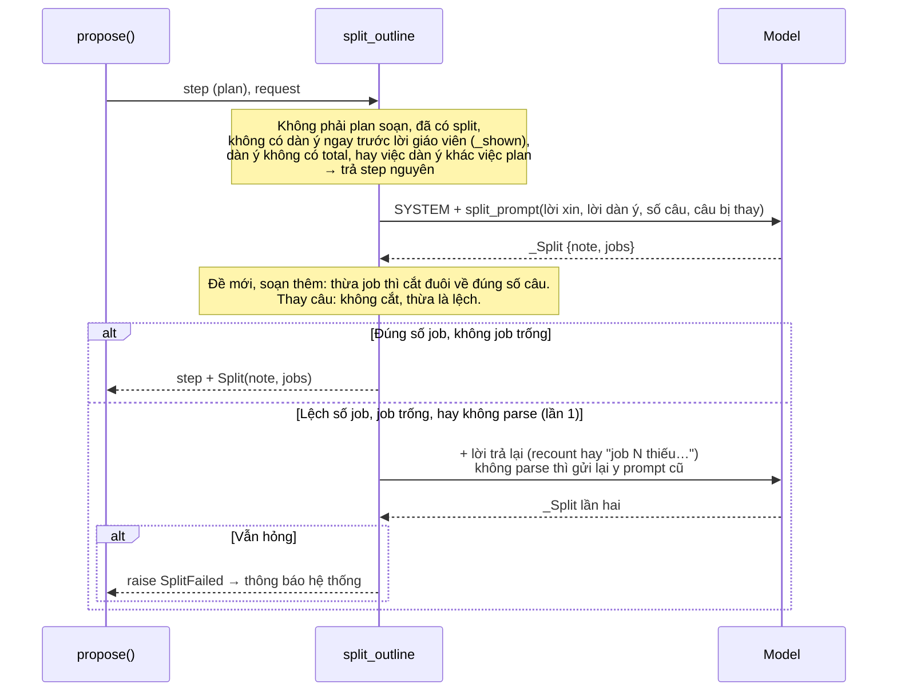

Mỗi job (`SplitJob`) là lời dặn tự đủ cho đúng một câu: `part`, `knowledge`, `formulas`, `approach`.
Người soạn câu không thấy dàn ý và không thấy các câu khác. Thay câu thì luôn là một job. `note` là
lời Kriky kể nó chia thế nào; BE lưu nó trên lượt `plan`, và FE hiện nó trong khối các bước
([Teacher Surface](teacher-surface.md)).

## Graph `authoring`: soạn một câu

Câu hỏi sơ đồ trả lời: *một câu của đề, hay một câu làm lại ở pha 2, được viết và tự kiểm thế nào?*

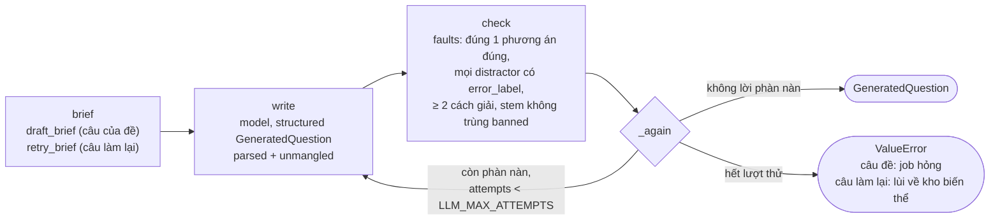

Lần thử không đọc được thành câu hỏi (`question` rỗng) cũng là một lời phàn nàn: *"sai hình dạng"*,
kèm lỗi giải mã cắt gọn.

- **Lời phàn nàn đi lại vào prompt** (`complaints`). Đó là điều khác giữa thử lại có lý do và gieo
  lại xúc xắc.
- **Đây không phải nơi ADR-18 được thi hành.** BE kiểm lại mọi câu tới tay nó. Phép kiểm ở đây chỉ
  là tự QC để tiết kiệm một vòng đi về; nếu nó lệch với BE thì BE mới là bên được tính.
- `brief` của câu đề lấy từ một job của dàn ý (ADR-38) và không bao giờ chở chữ tài liệu thô.
  `check_drafting_reads_no_document_text` canh điều này.
- `repair.unmangled` trả lại các dấu gạch chéo LaTeX bị bộ giải mã JSON nuốt (`\f` của `\frac`).

### Chuông tiến độ

Câu hỏi sơ đồ trả lời: *vì sao chuông "một câu xong" rung sau job, không rung trong job?*

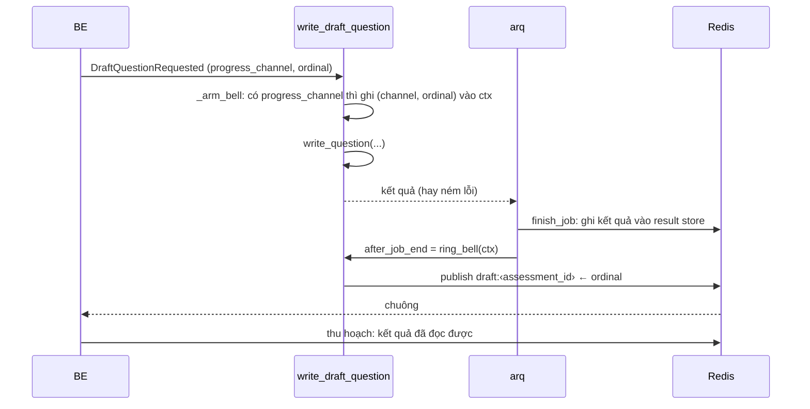

Chuông đặt **trước** khi làm việc, nên nó rung trên cả ba đường ra: model viết được, model hỏng, và
máy không có khoá. Chuông chở **số thứ tự, không chở câu hỏi** (ADR-25), vì pub/sub không bền, và
thứ gì nằm trong chuông là thứ có thể mất hẳn. Lỗi khi rung bị nuốt: câu đã nằm trong store rồi.

## Graph `explain`: lượt kèm học sinh

Câu hỏi sơ đồ trả lời: *chữ của trợ lý tới màn hình học sinh thế nào trong lúc model đang viết?*

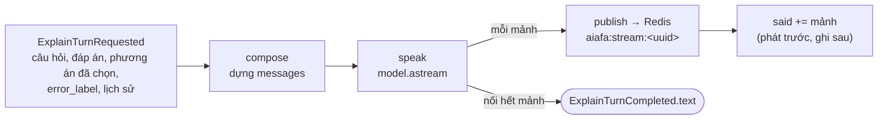

Hai luật định hình prompt:

- **Trợ lý giải thích, không kết luận.** Không điểm, không *"em đã hiểu rồi"* (ADR-16, ADR-20).
- **Lỗi đã có tên sẵn.** Trợ lý dùng đúng `error_label` người soạn gắn cho distractor (ADR-18).

`publish` đi qua `config.configurable`, không đi trong state, vì nó là một connection đang sống.

## Graph `naming`: đặt tên đoạn chat

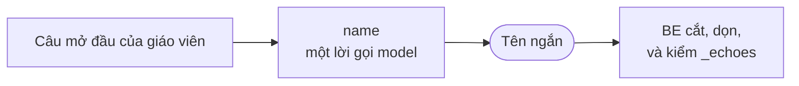

Task nhỏ nhất: không đọc lịch sử, không gọi tool. Prompt có một lối ra cho câu không nhờ việc gì, và
các ví dụ là cặp vào–ra, để model không mượn chữ của ví dụ. BE vẫn có một chốt kiểm thật
(`teacher_chat._echoes`), vì prompt chỉ là một lời nhờ.

## Thêm một skill, một luật, một task

**Một skill mới:**
1. Thêm `agent/skills/<ten>.md`, frontmatter `name` (trùng tên file) và `description` tiếng Anh.
2. Viết `description` như một tiêu chí Jev trả lời có/không được, gồm cả lời đáp ngắn tiếp nối việc
   ấy.
3. Không đặt luật an toàn trong thân skill.
4. `services/agent/tests/test_skills.py` đọc mọi skill. Đo việc chọn bằng `tools/skill_bench`, và
   **hỏi người dùng trước khi chạy bench**.

**Một luật sau model:**
1. Đặt nó trong module theo việc: `read_order.py` (thứ tự đọc), `plan_checks.py` (hình dạng plan),
   `outline.py` (dàn ý), `clarify.py` (nút).
2. Gọi nó trong `choose()` ở đúng chỗ của sơ đồ trên.
3. Luật sửa trả một `NextStepCompleted` khác; luật trả lại thì thêm một lớp con của `AskAgain`
   trong `ask_again.py`, có `hint` nói rõ sai ở đâu, và là `Flawed` nếu đề nghị vẫn dùng được.
4. Viết test trong `services/agent/tests/`. Đo trên model thật bằng `tools/propose_bench`, và hỏi
   người dùng trước khi chạy.

**Một task mới:**
1. Hằng số tên task và hai message `…Requested`, `…Completed` trong `packages/contracts`.
2. Handler `async (ctx, payload) -> dict` có cả đường mock và đường model, cùng cách xử khi model
   hỏng.
3. Một graph trong `graphs/`.
4. Đăng ký trong `WorkerSettings.functions` dưới hằng số.
5. Thêm một payload mẫu vào `PAYLOADS` của `test_no_routing_decision.py`. Thiếu thì
   `test_every_registered_task_has_a_payload_here` đỏ; có rồi thì test gọi task và soi kết quả.
   `check_contract.py` (`timeout-order`) so ngân sách thời gian của task với độ kiên nhẫn của BE.

## Bản đồ module

| Module | Việc |
| --- | --- |
| `worker.py` | Cấu hình arq: năm task, queue, `after_job_end`; log model đang dùng; che khoá trong log |
| `handlers.py` | Cửa vào của từng task; đường mock khi `LLM_ENABLED=false`; cách xử khi model hỏng; chuông |
| `config.py` | `Settings` đọc `.env`: provider, model, fallback, số lần thử, Jev |
| `llm.py` | Dựng model, truyền credential, `with_fallback` |
| `skill_router.py`, `skills.py`, `skills/*.md` | Jev chọn skill; đọc skill từ đĩa |
| `redact.py` | Che khoá API trong mọi log, kể cả traceback |
| `latex_escapes.py` | Trả lại dấu gạch chéo LaTeX bị JSON nuốt |
| `graphs/propose/graph.py` | `propose()`: chọn skill, chạy graph, hỏi lại một lần, chia việc |
| `graphs/propose/compose.py`, `prompt.py` | Dựng messages; chữ của `CORE` và các thủ tục |
| `graphs/propose/choose.py` | Gọi model, áp luật sau model theo thứ tự |
| `graphs/propose/proposal.py` | Khuôn `_Proposal` gửi model, và cách nó thành `NextStepCompleted` |
| `graphs/propose/ask_again.py` | Các lớp `AskAgain` và hint của chúng |
| `graphs/propose/read_order.py`, `books.py`, `history.py` | Luật thứ tự đọc; sách trong tầm; đọc lịch sử từ plan gần nhất |
| `graphs/propose/outline.py`, `plan_checks.py`, `clarify.py` | Dàn ý và lời đồng ý; hình dạng plan; nút của câu hỏi lại |
| `graphs/propose/split.py` | Chia dàn ý đã đồng ý thành job (ADR-38) |
| `graphs/authoring/` | Vòng viết, kiểm, thử lại; `brief.py`, `checks.py`, `repair.py` |
| `graphs/explain/` | Lượt kèm học sinh, stream |
| `graphs/naming/` | Đặt tên đoạn chat |
