# Architecture

## Mục đích tài liệu

Tài liệu này mô tả kiến trúc kỹ thuật của giai đoạn đầu Phase 2: có những service nào, chúng nói chuyện với nhau ra sao, ranh giới quyền quyết định nằm ở đâu, và cơ chế nào giữ cho ranh giới đó không bị phá.

Tài liệu này không mô tả nghiệp vụ. Nghiệp vụ thuộc về [Project Overview](project-overview.md), [Business Workflows](business-workflows.md) và [Use Case Specification](use-case-specification.md).

Sơ đồ trong tài liệu này, vẽ bằng Mermaid ngay cạnh lời văn:

- *System Architecture*: các service, kho dữ liệu và vùng mạng, ở mục
  [Năm service, sáu process](#năm-service-sáu-process);
- *Đường giao tiếp*: queue, result store và pub/sub giữa các service, ở mục
  [Đường giao tiếp](#đường-giao-tiếp);
- các luồng nhiều bước bất đồng bộ, ở mục [Các luồng chính](#các-luồng-chính):
  - một lượt chat giáo viên;
  - đời một câu hỏi của đề;
  - tải lên một tài liệu;
  - đường một tệp đi qua `document`;
  - tài liệu bị báo hỏng oan;
  - nộp bài và giai đoạn 2.

Bên trong AGENT, gồm ba tầng một đề xuất đi qua (mô hình, luật trong AGENT, `backend`), nằm ở
[Thiết kế AGENT](agent-design.md).

## Năm service, sáu process

| Service | Vai trò | Chạy bằng |
| --- | --- | --- |
| `fe` | Giao diện cho Teacher và Student. Chỉ nói chuyện với BE. | Vite dev server, cổng 5173 |
| `be` | Business layer, system of record, nơi giữ mọi quyết định nghiệp vụ. | uvicorn cổng 8000 |
| `agent` | Soạn nội dung bằng AI: câu hỏi của đề, câu của lượt làm lại, câu trả lời cho học sinh ở pha 2; trong chat giáo viên thì đề xuất bước tiếp theo, kể lại kết quả một plan và đặt tên đoạn chat. Phát nội dung, không quyết định. | arq worker, không có cổng |
| `document` | Đọc tệp giáo viên tải lên: dò chữ có sẵn, OCR bản chụp theo lô, ghi bản thô rồi dựng cây mục lục vào MongoDB, và báo trạng thái về `ingest`. Không sở hữu hàng nào. | hai arq worker (`document.ocr_worker`, `document.index_worker`), không có cổng |
| `ingest` | Ghi lại thứ `document` báo về. Giữ credential database, sở hữu không quyết định nào. | arq worker, không có cổng |

Câu hỏi sơ đồ trả lời: *có những service và kho nào, nằm ở vùng mạng nào, ai nối tới ai?*

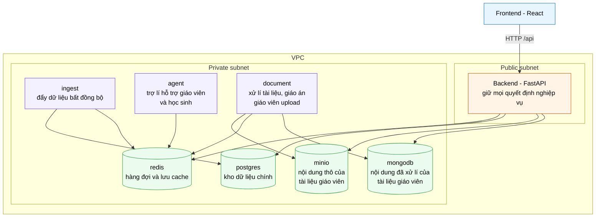

Bốn màu: **bề mặt** (vẽ, không giữ luật nào), **quyết định** (mọi luật nghiệp vụ), **báo lại, ghi
lại** (không quyết định), và **kho**.

**`ingest` giữ credential database, và nó vẫn là một service riêng.** Hai điều ấy
không mâu thuẫn, nhưng chúng đã từng bị đọc là mâu thuẫn, nên nói thẳng ra: cái làm
`agent` và `document` thành service đọc-và-báo là chúng **không ghi vào bảng nào** —
thứ chúng cần đi tới trong payload của job — chứ không phải việc chúng chạy process
riêng. Một service ghi một hàng thì cần đường tới hàng ấy.

Cái **thật sự** giữ ranh giới giữa `be` và `ingest` là một thứ khác, và nó đo được:
chúng không import nhau được. `lint-imports` cấm mọi chiều giữa bốn service, nên không
một luật nghiệp vụ nào của BE với tới được `ingest`, và danh sách những module bị cấm
thì **không tồn tại** — không có danh sách nào thì không có danh sách nào lỗi thời.

Hai service dùng chung đúng hai thứ, và cả hai là **khai báo**, không phải hành vi:
`packages/contracts` cho dữ liệu đi qua queue, `packages/schema` cho định nghĩa bảng.
Cái thứ hai là một cái giá đã nhận tường minh: hai service cùng ghi `documents` thì
dùng chung một định nghĩa schema, tức đổi một cột là một breaking change cho cả hai
cùng lúc. Đổi lại là một ranh giới `lint` được thay vì một ranh giới chỉ viết trong
văn bản.

Vì sao `ingest` phải rời khỏi `services/be`: từ 08/10/2026 tới plan 2c nó đúng là
process thứ hai của BE, và **không chỗ nào nói được process nào được làm gì**. Đo được
lúc ấy: `be/config.py` chở hai mươi trường cho một worker chạm năm; luật *API dựng
schema, worker chỉ kiểm* sống trong một docstring; và hai bootstrap gần giống nhau khác
đúng một dòng — trong đó một process đọc `LOG_LEVEL` còn process kia hardcode `INFO`.

Vòng xử lý tài liệu là thứ phá hình dạng cũ, vì **không ai chờ nó**: giáo viên đã rời
màn hình tải lên, và kết quả vẫn phải vào database. Một process đã rời đi thì không có
ai để trả 503 cho. Cho tới ngày ấy BE chưa bao giờ **tiêu thụ** một queue: nó đẩy job rồi đọc
kết quả từ result store, chờ ngay trong request hoặc thu lại sau; `be/queue.py` không có một
handler nào.

`document` và `ingest` **không mở cổng nào**, dù quy ước dưới dành cho `document` số
8100. Kết quả đi về bằng một job trên queue, không bằng một request, nên một cổng ở đó
là một bề mặt không ai canh. Số 8100 vẫn ghi là đã dành, để không ai cấp lại nó.

FE không biết AGENT tồn tại. Mọi thứ FE cần đều đi qua BE.

Một app phục vụ **hai** bề mặt, và chúng tách ở ba chỗ: route (`#/teacher…` rẽ trước mọi request),
phiên (mỗi vai một cookie, vai khai tại chỗ gọi endpoint), và stylesheet (`tokens.css`
giữ màu dùng chung, `teacher.css` giữ hình khối của giáo viên). Chúng **không** chia sẻ state nào.
Tên class của hai file không được trùng nhau: một class trùng tên không ghi đè mà **cộng vào**, nên
mọi property bản này không nhắc tới thì vẫn do bản kia quyết.

## Đường giao tiếp

Câu hỏi sơ đồ trả lời: *việc đi từ service này sang service kia bằng đường nào?*

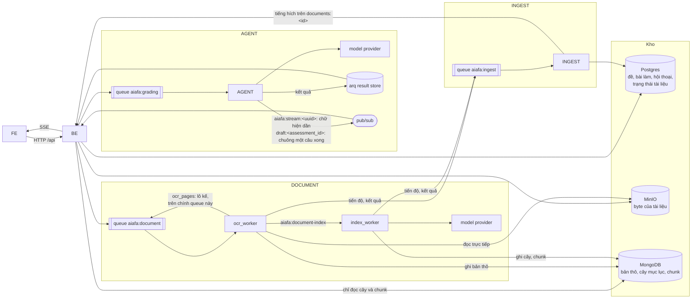

BE nghe tiếng hích của `ingest` rồi đẩy xuống FE qua SSE.

Đường xuống `document` và đường về `ingest` là **hai queue riêng**, không phải một đường hai
chiều, và mọi queue ở đây đặt tên theo **bên tiêu thụ** chứ không theo công việc. Lý do nằm ngay ở dòng trên:
`aiafa:grading` đặt tên theo công việc, rồi nhận thêm task khác, và nay chở năm task mà
không task nào chấm bài -- tên ấy nói dối. Một queue thì chỉ có một worker đứng sau, nên tên nói về bên tiêu
thụ không hết đúng được.

**`DOCUMENT` đọc MinIO trực tiếp, và không đọc Postgres.** Đó là cả lý do byte tài liệu
phải rời khỏi một cột `LargeBinary` ngày 08/10/2026: ba đường thay thế đều phá một luật
đang có. Nó cũng là lý do `DocumentProbeRequested` chở `storage_key` để đọc tệp; `document_id`
đi kèm chỉ để báo lại, vì một service không có credential database thì không tra được hàng nào.

Vì sao `DOCUMENT` không trả kết quả qua arq result store, cách `agent_gateway` đang
làm: `agent/worker.py` đặt `keep_result = JOB_RESULT_TTL_SECONDS`, nên **kết quả job hết
hạn**. Một tài liệu xử lý xong trong mười giây mà không ai đọc trong một giờ là một kết
quả bốc hơi. Một job tự mang dữ liệu đi thì không có hạn sống nào.

**Chấm bài không đi qua hàng đợi.** Nó là một phép so giữa phương án đã chọn và đáp án đúng trong
database của BE, nên nó chạy ngay trong request nộp bài
([ADR-20](../decisions/adr-20-cham-trac-nghiem-thuoc-be.md)). Hệ quả nhìn thấy được: giữa màn làm
bài và màn kết quả không có trạng thái *đang chấm* nào.

**Hàng đợi `aiafa:grading` dành cho sáu việc thật sự cần model.** Cả sáu đi qua queue vì AGENT
không mở cổng nào -- queue là đường duy nhất tới nó; BE lấy kết quả theo ba cách, nói ở đoạn sau
bảng:

| Task | Khi nào | BE làm gì với kết quả |
| --- | --- | --- |
| `write_draft_question` | **một câu** của bộ đề giáo viên yêu cầu | kiểm theo ADR-18 rồi lưu vào đúng vị trí đã yêu cầu |
| `generate_retry_question` | viết trước: lúc học sinh nộp bài pha 1, lúc mở phần chữa bài, và sau mỗi lượt làm lại được nộp; viết tại chỗ chỉ khi học sinh mở lượt mà chưa có câu viết trước | kiểm rồi lưu kèm đáp án đúng, để BE tự chấm lượt |
| `explain_turn` | mỗi tin nhắn học sinh gửi trong chat pha 2 (lời chào mở đầu do BE viết, không qua AGENT) | chuyển tiếp từng mảnh ra SSE, lưu khi câu trả lời đã trọn vẹn, rồi gửi `done` |
| `propose_next_step` | mỗi bước của một lượt chat giáo viên, trước khi có plan; và một lượt kể lại sau khi plan đã chạy (ADR-25, hậu ký 22/10/2026) | lưu lời nói hay câu hỏi lại, hiện dàn ý chờ giáo viên đồng ý, chạy tool đọc; hoặc kiểm cả plan -- plan soạn kèm cách AGENT chia dàn ý thành câu, đúng số câu của dàn ý (ADR-38) -- rồi chạy các việc ghi của nó. Ở lượt kể lại: chỉ tool đọc (cả `last_plan`), lời nói thành câu kết |
| `name_conversation` | lượt đầu của một đoạn chat giáo viên | đặt tên đoạn chat |

`write_draft_question` viết **một** câu một job, không phải cả bộ. Đó không phải khẩu vị mà là số
học: `tools/check_contract.py` so `SKILL_ROUTER_TIMEOUT_SECONDS + LLM_TIMEOUT_SECONDS ×
LLM_MAX_ATTEMPTS` với độ kiên nhẫn của BE cho **một** job (`AGENT_JOB_TIMEOUT_SECONDS`), nên
một job soạn 50 câu là 50 lần ngân sách mà check đang kiểm. Task cũ
`draft_assessment` làm đúng thế, và check nói dối về nó suốt thời gian nó tồn tại.

BE không bao giờ trả `job_id` cho FE, và lấy kết quả theo ba cách:

- **Chờ ngay trong request** (`agent_gateway.run_task`): ba task của chat giáo viên, và câu làm lại
  khi phải viết tại chỗ. Người dùng đang nhìn, nên thêm một giao thức poll thứ hai chồng lên arq
  không mua được gì.
- **Nghe trước rồi mới đẩy** (`stream_task`): `explain_turn`, để chữ hiện dần.
- **Bắn rồi thu sau** (`enqueue_task` rồi `collect_result`): `write_draft_question` và câu làm lại
  viết trước. BE giữ `job_id` trong một hàng của chính nó (`DraftItem`, `PregeneratedItem`) và
  *thu hoạch* kết quả mỗi khi một màn hình hay một lượt chat đọc tới. BE không có worker nào chạy
  nền, nên một kết quả không ai đến thu thì hết hạn cùng result store; lần thu kế thấy nó đã mất
  và đặt lại job, chứ không mất câu.

**Thư viện tài liệu cũng dùng SSE.** Đó là kênh SSE thứ hai của giáo viên, sau luồng trả về của
một lượt chat (`POST /api/teacher/chat/messages/stream`), và là kênh duy nhất sống suốt thời gian
màn hình mở: `GET /api/teacher/documents/stream`. Nó tồn tại vì thư viện đổi **sau** lúc tải lên và không lời gọi nào của
màn hình gây ra việc ấy: một tài liệu đi từ *đang xử lý* sang *sẵn sàng* vài giây
sau, hoặc vài phút sau khi queue đang dồn.

**Kênh chỉ hích, không chở dữ liệu.** Mỗi khung chỉ nói *có gì đó đổi*; trình duyệt
nghe xong thì gọi lại `GET /api/teacher/documents`. Lý do là một bài học đã trả giá
một lần ở chuông tiến độ: pub/sub của Redis **không giữ lịch sử**, nên một khung chở
dữ liệu mà mất đi là một chip sai vĩnh viễn, còn một tiếng hích mất đi thì tiếng sau
sửa luôn. Hệ quả bắt buộc: trình duyệt vẫn phải đọc danh sách một lần lúc mở màn
hình — kênh này không bao giờ là nguồn đầu tiên.

**Hai service đứng hai đầu**, không hai process của một service: `ingest` **phát** sau
khi ghi xong kết quả xử lý, `be` **nghe** và đẩy xuống. Một channel cho mỗi **giáo
viên** (`documents:<id>`), vì rail vẽ cả thư viện chứ không vẽ từng tài liệu rời.

Tên channel sống ở `contracts.documents_channel`, và đó là chỗ duy nhất nó được viết
ra. Hai service ấy không import nhau được, nên cái string **là** ranh giới, đúng như mọi tên task
trong `contracts`. Đáng một check riêng vì lúc hai bản sao lệch nhau thì
**không có lỗi nào**: `publish` vào một channel không ai nghe thành công y như một
channel có người nghe, và triệu chứng duy nhất là chip thôi tự đổi mặt.

**Chat của học sinh dùng SSE.** `GET /api/attempts/{id}/chat/stream` trả `text/event-stream`, chữ
hiện dần. Nó là **kênh tăng tốc cảm giác, không phải nguồn sự thật**: từng mảnh được chuyển tiếp
ngay khi AGENT viết ra, còn lượt trả lời chỉ được lưu khi đã trọn vẹn, sau mảnh cuối. Mất kết nối
giữa chừng thì câu trả lời ấy mất -- không bao giờ lưu nửa vời, cũng không lưu hai lần -- và trợ
lí chỉ trả lời lại khi học sinh gửi tin nhắn tiếp theo, vì màn hình chỉ tự xin một lượt khi lịch
sử còn trống (`Tutor.tsx`). Client đọc lại lịch sử bằng REST sau mỗi lần stream.

FE gọi đường tương đối `/api` và Vite proxy sang BE, nên trình duyệt chỉ làm việc với một origin duy nhất và BE không cần cấu hình CORS.

## Các luồng chính

Mỗi luồng ở đây đi qua nhiều hơn một bước bất đồng bộ, nên lời văn ở mục trên không đủ để thấy thứ
tự của nó. Báo cáo môn học vẽ cùng các luồng này bằng drawio (`docs/diagrams/`); đổi luồng là đổi
cả hai bản.

### Một lượt chat giáo viên

Câu hỏi sơ đồ trả lời: *một tin nhắn của giáo viên đi qua những gì, từ lúc gửi tới lúc nhả đoạn
chat?*

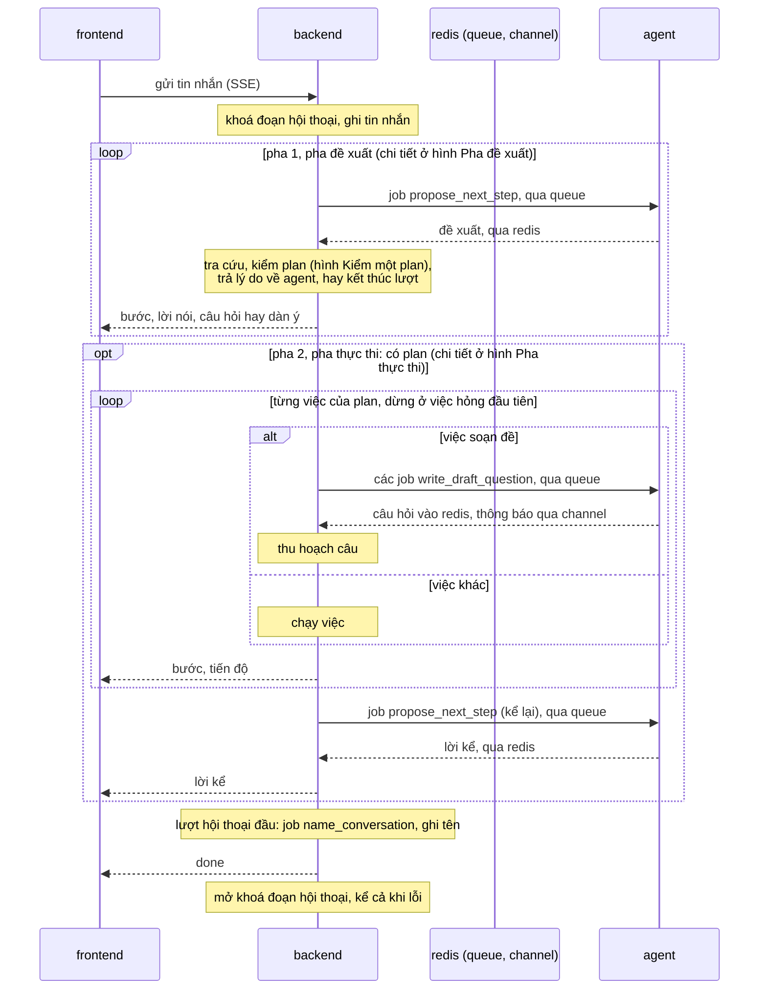

Ba hình dưới tách lượt ấy ra từng phần, mỗi phần đủ nhánh.

**Pha đề xuất**: lặp khi còn tra cứu, hay khi đề xuất bị trả lại.

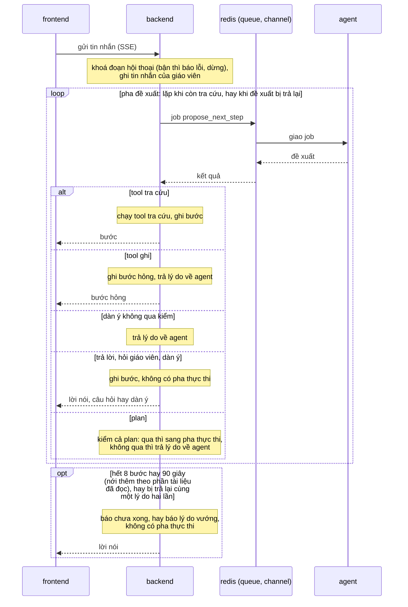

**Kiểm một plan**: hai cửa kiểm, hỏng mỗi cửa một kết cục.

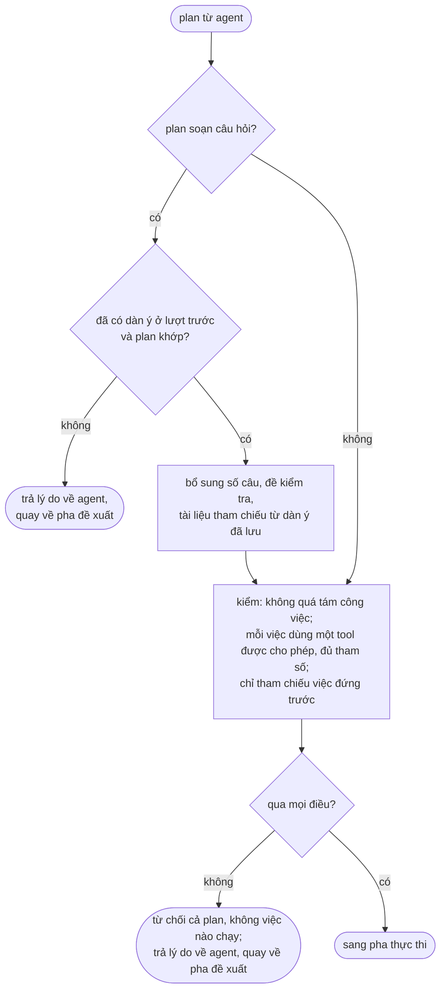

Từ ADR-38, cửa đầu còn đòi plan soạn mang cách AGENT chia dàn ý, đúng số câu của dàn ý
(`guard_drafting`); hình báo cáo vẽ trước ADR-38 nên chưa có chi tiết ấy.

**Pha thực thi**: có plan.

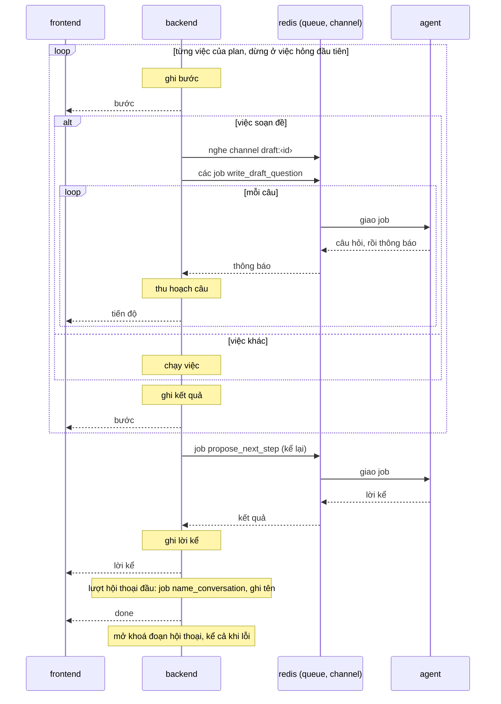

Một đề xuất đi qua ba tầng trước khi tới cửa kiểm plan của `backend`: mô hình, rồi luật trong
AGENT. Hai tầng đầu được vẽ ở [Thiết kế AGENT](agent-design.md#graph-propose-một-bước-của-lượt-chat-giáo-viên).

### Đời một câu hỏi của đề

Câu hỏi sơ đồ trả lời: *một vị trí câu được viết, kiểm, thu hoạch và ghi thế nào?*

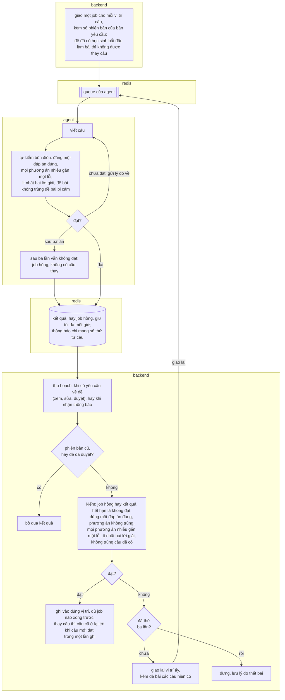

### Tải lên một tài liệu

Câu hỏi sơ đồ trả lời: *một tệp đi qua đủ ba hình thức giao tiếp (API, job qua queue, thông báo qua
channel) thế nào?*

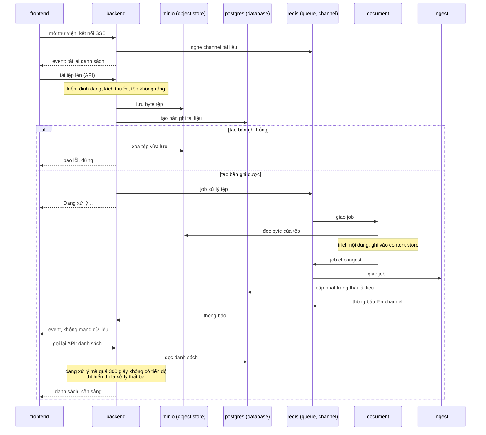

### Một tệp đi qua `document`

Câu hỏi sơ đồ trả lời: *hai worker của `document` làm gì với một tệp, và mô hình ngoài nào được gọi
ở khâu nào?*

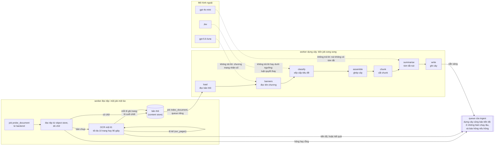

### Tài liệu bị báo hỏng oan

Câu hỏi sơ đồ trả lời: *bảy cuốn đọc xen kẽ từng lô thì vì sao `backend` báo hỏng một cuốn vẫn
đang chạy?*

```mermaid
gantt
    dateFormat X
    axisFormat %s
    section cuốn 1
        lô 1 : 0, 45
        lô 2 : 315, 360
    section cuốn 2
        lô 1 : 45, 90
    section cuốn 3
        lô 1 : 90, 135
    section cuốn 4
        lô 1 : 135, 180
    section cuốn 5
        lô 1 : 180, 225
    section cuốn 6
        lô 1 : 225, 270
    section cuốn 7
        lô 1 : 270, 315
    section backend thấy cuốn 1
        đang xử lý : 0, 345
        báo hỏng : crit, 345, 360
        đang xử lý : 360, 405
```

Trục là giây. Từ giây 45 tới giây 345, cuốn 1 không có tiến độ nào: 300 giây, đúng ngưỡng. `backend`
báo cuốn 1 hỏng từ giây 345 tới khi lô 2 của nó báo tiến độ ở giây 360.

### Nộp bài và giai đoạn 2

Câu hỏi sơ đồ trả lời: *từ lúc nộp bài tới lúc học sinh nhận câu của một lượt làm lại, những job nào
chạy và khi nào?*

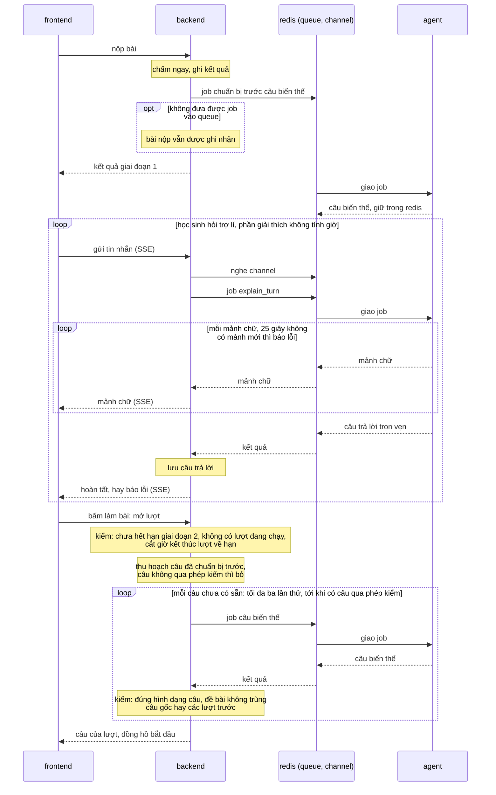

## Ranh giới quyền quyết định

Đây là ràng buộc nghiệp vụ quan trọng nhất trong kiến trúc.

Luật chỉ có một câu: **AGENT nộp nội dung, BE quyết định nội dung ấy có được dùng hay không.**

- AGENT trả về một **đề xuất**: câu hỏi, các phương án, ánh xạ từ mỗi nhiễu sang một lỗi, lời giải.
- BE **kiểm lại từng câu trước khi ghi** — đúng một đáp án đúng, mọi nhiễu gắn một lỗi, ít nhất hai
  cách giải (`agent_gateway.py`, gọi trước mọi đường ghi) — và một đề chỉ rời trạng thái nháp khi
  giáo viên bấm duyệt. Một luật nghiệp vụ chỉ được nhắc trong prompt là một luật không được thi hành.

Việc chấm đi xa thêm một bước: **AGENT không bao giờ trả về điểm**. Nó *biết* đáp án -- nó soạn ra
đáp án, và job `explain_turn` chở cả đáp án đúng lẫn phương án học sinh đã chọn -- nhưng việc chấm nằm
trong request nộp bài của BE ([ADR-20](../decisions/adr-20-cham-trac-nghiem-thuoc-be.md)), và không
thứ gì AGENT trả về được dùng làm điểm.

Nếu để AGENT tự quyết định, cổng teacher-in-the-loop sẽ nằm bên trong AI service, trái nguyên tắc
trong [Project Overview](project-overview.md).

Luật này có lưới canh: `services/agent/tests/test_no_routing_decision.py` gọi **mọi task đã đăng ký**
trong `WorkerSettings.functions` rồi soi kết quả, và đỏ nếu một trường mang tên phán xử xuất hiện ở
bất kỳ độ sâu nào.

## Ranh giới dữ liệu

Postgres có hai bên ghi: BE, qua process API -- process duy nhất của nó, vì BE không có worker
nào -- và `ingest`. Cả hai giữ cùng một credential Postgres (`DATABASE_URL`) và đọc cùng một
định nghĩa bảng trong `packages/schema` (`schema/models.py`); chỉ BE dựng schema, `ingest` chỉ
kiểm. Ranh giới ở đây là
ranh giới **sở hữu**, không phải ranh giới process: mọi quyết định về các hàng ấy là của BE, còn
`ingest` chỉ ghi lại thứ `document` báo về. Hai mươi hai bảng và lý do của chúng nằm ở
[Data Model](data-model.md).
[ADR-21](../decisions/adr-21-trang-thai-bai-lam-la-ben.md) là lý do Postgres có mặt: hạn pha 2 do giáo
viên đặt, tính bằng giờ hoặc ngày, nên trạng thái bài làm không thể sống trong một chỗ có TTL một
giờ. `JOB_RESULT_TTL_SECONDS` vẫn còn và vẫn đúng — nó nói về kết quả một job của arq, không nói về
bài làm của học sinh.

MinIO là **object store** duy nhất, nơi byte của tài liệu giáo viên nằm. Không tính Redis --
đường đi chung của cả bốn service Python -- thì mỗi kho có đúng **hai** service chạm tới: Postgres
(BE và `ingest`), MinIO (BE ghi, `document` đọc), MongoDB (`document` ghi, BE chỉ đọc). Với
MinIO, `documents.storage_key` trong Postgres là khoá,
còn bảng thì không giữ một byte nào. Chúng rời khỏi một cột `LargeBinary` ngày 08/10/2026 vì
`services/document` — service đọc tệp — không có credential database, nên nó không với tới
được một cột; ba đường thay thế đều phá một luật đang có.

**BE ghi, `document` đọc, và không có chiều ngược lại.** `document/storage.py` không có `put`,
và sự thiếu vắng ấy là thiết kế chứ không phải việc chưa làm: một `put` thứ hai là một đường
thứ hai để byte vào bucket, và hai đường thì sớm muộn khác nhau ở một chỗ — content type, sơ
đồ khoá, hay thứ tự với hàng trong database.

Việc `document` giữ khoá của MinIO **không** phá dòng *"BE sở hữu mọi database"*, và lý do
đáng nói ra chứ không nên để người đọc tự suy: object storage là nơi **byte** nằm, không phải
nơi **sự thật** nằm. Một tài liệu đã xử lý xong hay chưa thì chỉ `documents.state` trong
Postgres biết, và chỉ BE với `ingest` chạm cột ấy: BE tạo hàng ở `processing` và tự ghi `failed`
khi không giao được job, `ingest` ghi kết quả `document` báo về, còn *đứng quá lâu* thì BE suy ra
lúc đọc. `document` đọc một tệp rồi báo
lại; nó không bao giờ biết câu trả lời của nó đã được ghi hay chưa.

Trong mỗi service, **đúng một module** được import `minio` — `be/storage.py` và
`document/storage.py` — và `tools/check_contract.py` canh cả hai bằng một hàm. Lý do không
phải gọn gàng: SDK là sync còn cả hai bên đều async, nên mỗi lời gọi phải đi qua một thread,
và một chỗ quên không ném gì cả — nó chỉ chặn event loop suốt thời gian một cuốn sách đi qua.
Gom vào một module biến luật *"nhớ bọc thread"* thành luật *"nhớ đừng import"*, và luật thứ
hai thì grep được.

**MongoDB là kho nội dung, cùng lập luận với MinIO** (plan 3b, 11/10/2026). Sau khi đọc một tệp,
`document` ghi **bản thô** của nó -- chữ chia trang và khối, có hộp, có nhãn layout khi qua OCR --
vào database `aiafa_content`, **trước** khi báo `READY` (*"chunk trước, `state` sau"*). Mongo giữ
**thứ đọc được từ tệp**, không giữ **sự thật về tệp**: tài liệu xong hay chưa vẫn chỉ
`documents.state` trong Postgres trả lời. Nên `document` được giữ khoá Mongo mà luật *"không giữ
credential database"* không đổi -- `tools/check_contract.py` dùng một mẫu nới riêng cho
`services/document` (cho `MONGO_*`, vẫn cấm Postgres), AGENT vẫn mẫu chặt. Hình dạng dữ liệu khai ở
`contracts.content`, không ở Mongo. `pymongo` được import ở đúng hai module:
`document/content_store.py` để ghi, `be/content_reader.py` để đọc -- và
`check_the_content_reader_only_reads` giữ chữ *chỉ đọc* của module thứ hai. Hàm seam bên dưới quét
cả bốn service, nên `ingest` và AGENT không có cửa nào. Bản thô là bất biến: chỉ đường đọc
tệp ghi `pages`; *document agent* của plan 3c ghi cây và chunk vào collection của riêng nó
(`indexes`, `nodes`, `chunks`, `block_labels`, hình dạng ở `contracts.index`), và đọc lại tài liệu là
xoá cây cũ.

**PDF scan đi đường OCR theo lô trang** (plan 3b, Task 3). Lần dò tệp thấy một PDF có trang mà
không có chữ thì không báo *không đọc được chữ* nữa: nó mở đầu mục bản thô rồi giao lô đầu
(`ocr_pages`, mặc định 10 trang ≈ 45 s) cho chính queue `aiafa:document` của nó. Mỗi lô ghi trang của nó
vào Mongo, gửi `DocumentProgress` về `ingest` (cột `pages_read`, `progress_at`), rồi tự giao lô kế;
lô cuối gửi `NO_TEXT_LAYER` khi cả cuốn không ra chữ nào, còn có chữ thì giao job dựng cây (đoạn
dưới). Phép suy
*đứng quá lâu* của BE đo từ `max(uploaded_at, progress_at)`, nên một cuốn đọc mười lăm phút mà vẫn
tiến không bị gọi là chết, còn một chuỗi lô ngừng tiến thì vẫn bị. `document.ocr_worker` chạy
**một job một lúc** (`max_jobs = 1`): OCR dùng hết luồng CPU, hai lô song song chỉ tranh nhau.

**`READY` chờ cây** (plan 3c, 11/10/2026). Bản thô xong thì tài liệu **chưa** sẵn sàng: `document`
giao một job `index_document` cho **process thứ hai** của chính service ấy, `document.index_worker`,
trên queue riêng `aiafa:document-index`. Hai process vì hai việc khác nhau đúng ở chỗ cấu hình worker
quyết: OCR ăn hết CPU nên chạy một job một lúc và nạp ba model; dựng cây thì **chờ mạng** -- Jev xếp
cấp từng tiêu đề, `gpt-5.6-luna` đọc tên chương trên ảnh banner, `gpt-4o-mini` tóm tắt từng nút --
nên chạy vài job song song và không nạp model nào. Job ghi cây vào Mongo **rồi mới** gửi `READY`
(*"chunk trước, `state` sau"*), gửi `DocumentProgress` ở mỗi khâu dài để phép suy *đứng quá lâu* không
cắt nó, và gửi `FAILED` kèm lý do khi hỏng theo cách arq không chạy lại. Jev hay OpenAI không với
tới được thì **không** hỏng: cây đi đường luật, hoặc thiếu tóm tắt, và `IndexHeader` nói kém ở đâu.
Đây là agent riêng của `document`, không phải Kriky -- khác queue, khác prompt, khác model -- và nó
làm `document` thành service thứ hai gọi model provider. Hai seam mới canh việc ấy: `typesafe_sdk`
mỗi service gọi Jev ở đúng một module (`document/index/jev.py`, và `agent/skill_router.py` nơi AGENT
chọn skill),
`langchain` trong `document` chỉ ở `document/index/llm.py`
(nơi duy nhất truyền khoá vào client), và BE cùng `ingest` không import SDK model nào.

Cùng hàm ấy canh `pymupdf`, và nhà của nó là `document/pdf.py`. `ocr_worker` chạy một job một lúc
nhưng event loop vẫn phải rảnh cho kết nối Redis và Mongo trong lúc OCR một trang; `index_worker`
chạy tới bốn job, nên dựng ảnh banner mà chặn loop là chặn cả ba job kia. Mọi lời gọi sync đi qua
`asyncio.to_thread`.

AGENT và `document` không nhận credential của Postgres (`document` giữ khoá MinIO và Mongo,
không giữ khoá Postgres), nên **một job phải tự chứa**: `explain_turn` mang theo cả câu hỏi, phương án, lời giải và lỗi đã soạn chứ không mang
id để tra, và `DocumentProbeRequested` mang `storage_key` chứ không mang một hàng.
`tools/check_contract.py` canh điều này bằng cách quét mọi file Python của **cả hai** service
tìm dấu vết truy cập database.

Bảng được tạo từ metadata của model lúc khởi động, chưa có công cụ migration. Đó là một món nợ có
chủ đích: schema hiện có một người dùng và chưa có dữ liệu thật nào. Ngày có dữ liệu thật, đánh đổi
ấy lật ngược.

## Shared code

Có hai package dùng chung. `packages/contracts` được cả bốn service Python import, và là thứ duy nhất BE và AGENT cùng import. Nó chỉ chứa dữ liệu: message, enum, hằng số tên task, hình dạng dữ liệu nằm trong MongoDB (`content.py`, `index.py`), và vài hàm thuần dựng tên khoá hay tên channel. `packages/schema` khai bảng Postgres cho hai service cùng ghi, BE và `ingest`. Không có logic nghiệp vụ, vì bất cứ hành vi nào đặt ở đây sẽ trở thành hành vi dùng chung mà không service nào sở hữu.

Tên task là hằng số trong `contracts`, nên BE enqueue bằng chuỗi và không bao giờ phải import `agent`. Tên queue thì không nằm ở đó: nó là cấu hình trong `.env` mà mỗi service tự đọc.

Hai loại package dùng chung khác chưa được tạo và chỉ tạo khi có nhu cầu thật: một thư viện hạ tầng không dính nghiệp vụ, và một client TypeScript sinh từ OpenAPI của BE. Không tạo package tên `common`, `utils` hay `shared`, vì tên vô nghĩa sẽ hút mọi thứ vào.

## Cơ chế giữ ranh giới

Bốn service Python (`be`, `agent`, `document`, `ingest`) và hai package dùng chung hiện cài chung một conda env. Đó là quyết định về thao tác, không phải về kiến trúc, nhưng nó có hệ quả: **không có gì chặn được import chéo lúc chạy**.

Vì vậy ranh giới chỉ còn một cơ chế duy nhất đỡ, và nó phải tự động:

- `import-linter` cấu hình trong `pyproject.toml` với ba contract: bốn service `be`, `agent`, `document`, `ingest` độc lập với nhau, và cả `contracts` lẫn `schema` không được import ngược lên service nào.
- Hook pre-commit chạy nó mỗi lần commit, dùng đường dẫn tuyệt đối tới interpreter của conda env.

Hai lưu ý khi sửa cấu hình này:

- Phải gọi console script `lint-imports`. Lệnh `python -m importlinter.cli` thoát 0 mà không kiểm tra gì — một false pass sẽ vô hiệu hoá toàn bộ cơ chế mà không ai biết.
- Sáu package Python dùng `setuptools` chứ không phải `hatchling`, vì editable install của hatchling khiến `grimp` có thể không dựng được đồ thị import và im lặng báo không có vi phạm.

Cách duy nhất biết hàng rào còn sống là thử phá nó: thêm `import be` vào `services/agent/src/agent/worker.py`, chạy `.\dev.ps1 check`, xác nhận nó fail, rồi hoàn tác.

## Diagram nào đã có, và vì sao chưa có các loại khác

Từ 13/11/2026 sơ đồ có hai nơi, theo người đọc (`AGENTS.md`, *Documentation Rules*):

- **Docs Markdown vẽ bằng Mermaid**, ngay cạnh lời văn, vì người đọc là dev mở repo trên GitHub hay
  trong IDE.
- **Báo cáo môn học vẽ bằng drawio** (`docs/diagrams/*.drawio`, mười sáu file), vì LaTeX cần PDF
  vector có bố cục tay. Mỗi file là một hình của báo cáo; `tools/check_contract.py` đỏ khi hình
  xuất ra cũ hơn file.

Một luồng có trong cả hai thì đổi cả hai cùng lúc. Mọi hình của báo cáo đều có bản Mermaid trong
docs, trừ `propose-three-layers`: docs vẽ luồng ấy chi tiết hơn và theo code hiện tại, ở
[Thiết kế AGENT](agent-design.md).

**Sequence Diagram** có ở mục [Các luồng chính](#các-luồng-chính): một lượt chat giáo viên, tải lên
một tài liệu, nộp bài và giai đoạn 2. Cả ba đạt điều kiện đặt ra ở đây từ trước: luồng có nhiều hơn
một bước bất đồng bộ. Một lượt chat giáo viên, chẳng hạn, đi qua queue ít nhất hai lần (đề xuất
bước tiếp theo, kể lại kết quả), có thể nghe chuông soạn đề qua pub/sub, và pha 1 của nó kết thúc
theo nhiều cách.

**ERD** có từ 13/11/2026, ở [Data Model](data-model.md): quan hệ khoá ngoại của 23 bảng, cùng vòng
đời trạng thái của một đề. Class Diagram thì không vẽ: code không có lớp miền nào ngoài các model
của bảng. Domain Context ở
[Project Overview](project-overview.md) chỉ mô tả boundary và tương tác với Teacher, Student; nó
không mô tả object nội bộ hay schema.

**Deployment Diagram** chưa có riêng. Vùng mạng của từng service nằm ngay trên sơ đồ ở mục
[Năm service, sáu process](#năm-service-sáu-process); hạ tầng lab vẽ đủ ở
[Kiến trúc lab](../operation/infrastructure.md). Mục "Năm service, sáu process" và
`docs/local-development.md` vẫn là nơi nói tiến trình nào chạy bằng gì trên máy local.

## Quy ước đặt tên service mới

| Thứ | Quy tắc | Ví dụ |
| --- | --- | --- |
| Tên thư mục | Chữ thường, đặt theo domain chứ không theo tầng | `services/review-queue` |
| Python import package | snake_case của tên thư mục, nằm dưới `src/` | `src/review_queue/` |
| Tên distribution | Tiền tố `aiafa-` để không đụng tên trên PyPI | `aiafa-review-queue` |
| Tiền tố biến môi trường | UPPER_SNAKE | `REVIEW_QUEUE_DB_DSN` |
| Cổng | BE 8000, service mới cộng thêm 100 | `8100`, `8200` |

`be`, `agent` và `fe` là ngoại lệ của quy tắc đặt theo domain vì chúng là tầng chứ không phải domain. Service thứ tư trở đi đặt theo domain — `services/document` là cái đầu tiên, `services/ingest` là cái thứ hai — và cả hai theo đúng bảng trên ở mọi dòng trừ **cổng** và **tiền tố biến môi trường**: chúng không mở cổng nào, nên 8100 chỉ là một số đã dành; và không service nào dùng tiền tố, vì cả bốn service Python đọc chung một `.env` theo những tên dùng chung (`REDIS_URL`, `DATABASE_URL`, `MINIO_*`, `MONGO_*`).

Mỗi service giữ `pyproject.toml` riêng khai báo đúng dependency của mình, kể cả khi đang dùng chung môi trường. Nhờ vậy lúc tách service ra không phải viết lại gì, chỉ đổi cách cài đặt.
