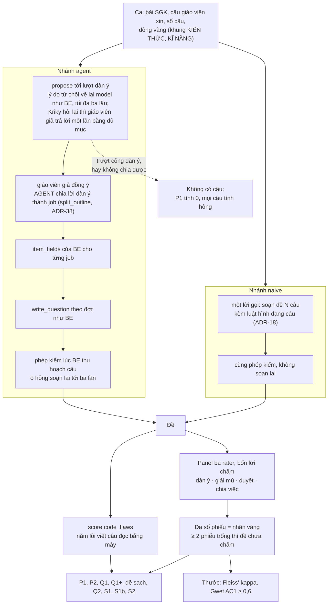

# Thiết kế chấm chất lượng nội dung

Tài liệu này giữ cách đo chất lượng thứ model viết ra. Hiện có một phần: **bench chất lượng ra đề**
(`tools/exam_bench`, plan `exam-quality-bench`). Prompt và lựa chọn model chưa viết ở đây; chúng vẫn
nằm trong code của `services/agent` và các plan đã đóng.

## Bench chất lượng ra đề

### Đo gì

Hai điểm giáo viên quyết định khi Kriky ra đề:

1. **Dàn ý có duyệt được không** -- trước khi câu nào được soạn (ADR-29).
2. **Đề lần đầu có phát hành được mà không sửa không** -- trước khi giáo viên chạm vào câu nào.

Bench không đo độ khó, độ phân biệt câu hay lỗi thật của học sinh: những số ấy cần bài làm thật.

### Bộ ca và vàng

`tools/exam_bench/cases.json`: mỗi ca là một bài SGK Kết nối tri thức (lớp 6, 8, 10, 12; số học, đại
số, hình học, thống kê, giải tích; một ca phủ hai bài), một câu giáo viên xin đề, số câu xin. **Vàng**
là khung *KIẾN THỨC, KĨ NĂNG* sách in đầu mỗi bài: yêu cầu cần đạt do sách viết sẵn, không phải tiêu
chí tự nghĩ. SGK trong `data/` là ảnh scan, nên khung ấy được chép tay từ ảnh trang, một lần. Câu
giáo viên của ca chịu luật *câu đo không nằm trong prompt* (`tools/tests/test_propose_bench.py`).

### Hai nhánh

| Nhánh | Đường đi | Ghi chú |
| --- | --- | --- |
| `agent` | Đúng đường của Kriky, vẽ ở sơ đồ dưới | Cùng model và cấu hình trong `.env`. Trước ADR-38 (pilot `run-130`): dàn ý có mục cấu trúc, BE chia mục thành ô (`place_items`) |
| `naive` | Một lời gọi tới cùng model: *"soạn đề N câu…"* kèm luật hình dạng câu (ADR-18) | Cùng phép kiểm, không soạn lại; đường so để biết agent thêm được gì |

Câu hỏi sơ đồ trả lời: *một ca đi qua bench thế nào, từ câu giáo viên xin tới các chỉ số?*



### Panel rater và nhãn vàng

Ba rater: `claude-opus-5-5`, `claude-sonnet-5-5`, `claude-opus-4-8` -- khác hạng và khác thế hệ, không
rater nào là model sinh đề. **Đa số phiếu là nhãn vàng.** Mọi tiêu chí là câu có/không kèm lý do. Bốn
loại lời chấm:

| Lời chấm | Rater thấy | Tiêu chí |
| --- | --- | --- |
| Dàn ý | Yêu cầu, dòng vàng, các mục (từ ADR-38: các job Kriky chia) | Mục kiểm dòng vàng nào; D1 cụ thể, D2 công thức đúng, D3 vừa khối và phạm vi, D4 không trùng mục khác |
| Giải mù | Đề và phương án, **không** đáp án, lỗi ghi kèm hay lời giải | Từng phương án có đúng không |
| Duyệt | Đề, đáp án khoá, lỗi ghi kèm từng phương án nhiễu, mục dàn ý (từ ADR-38: job của câu) | Bảy loại lỗi nặng; câu có bám mục; từng phương án nhiễu có tái tạo được bằng đúng lỗi ghi kèm |
| Chia việc | Lời dàn ý giáo viên đã đọc, các job AGENT chia ra | Mỗi job: trung thành với dàn ý, tả đúng một câu, khác câu anh em; cả đề: dàn ý phủ đủ, đúng số câu |

Năm lỗi viết câu đọc được bằng máy -- hai phương án trùng chữ, phương án *"tất cả các phương án
trên"*, đáp án dài bất thường, đề có hai câu hỏi, đề chép lại phương án -- do code bắt
(`score.code_flaws`), không giao rater.

### Chỉ số

| Chỉ số | Định nghĩa |
| --- | --- |
| **P1 độ phủ** | Tỉ lệ dòng vàng được ít nhất một mục phủ, mẫu số `min(số câu, số dòng vàng)`; dàn ý trượt cổng tính 0 |
| **P2 mục duyệt được nguyên** | Mục qua cả D1–D4 |
| **Q1 câu dùng được nguyên** | Giải mù ra đúng khoá ∧ đúng một phương án đúng ∧ không lỗi nặng ∧ không lỗi code, **trên mọi câu được xin** -- đề trượt cổng, ô hỏng, câu không trả đều là câu không dùng được. Cùng phép cho hai nhánh |
| Q1 lõi | Q1 bỏ *không lỗi nặng*: chỉ giải mù và luật code. Phần của Q1 không phụ thuộc thứ rater thấy kèm câu (mục hay job), nên dùng để so hai lượt có ngữ cảnh duyệt khác nhau |
| Q1+ | Q1 cộng *bám mục dàn ý*, chỉ nhánh `agent` |
| Đề sạch | Đề đủ số câu xin và mọi câu dùng được nguyên |
| **Q2 phương án nhiễu trung thực** | Phương án nhiễu mà lỗi ghi kèm tái tạo đúng nó, chỉ trên câu có khoá đúng |
| S1 job trung thành | Job khớp lời dàn ý, không thêm, không đổi (ADR-38) |
| S1b một câu, khác anh em | Job tả đúng một câu và khác các job cùng phần |
| S2 dàn ý phủ đủ | Mọi phần của dàn ý có job, đúng số câu |

Từ ADR-38, P1 và P2 chấm **các job** AGENT chia, vì dàn ý không còn mục có cấu trúc: P1 là độ phủ
khung yêu cầu cần đạt của các câu sẽ soạn, P2 là job duyệt được nguyên. Hai số này không so thẳng với
P1, P2 của pilot `run-130` (mục do Kriky viết cùng dàn ý).

#### Đọc các chỉ số thế nào

Các chỉ số đi theo đúng thứ tự giáo viên gặp: dàn ý, rồi lời dặn từng câu, rồi câu hỏi.

Lấy ví dụ ca `tap-hop-6`:

- **Câu xin:** *"Soạn giúp mình 5 câu trắc nghiệm về tập hợp và phần tử của tập hợp cho học sinh
  lớp 6"*.
- **Ba dòng vàng:** nhận biết tập hợp và phần tử; mô tả một tập hợp; dùng kí hiệu và cách diễn đạt
  toán học nhờ tập hợp.

**Dàn ý: Kriky định soạn đúng thứ sách yêu cầu chưa?** (chỉ nhánh `agent`)

Từ ADR-38, *mục* ở P1 và P2 là lời dặn của từng câu mà AGENT chia ra (job), không còn là mục có cấu
trúc do Kriky viết cùng dàn ý. Vì vậy mẫu số của P2 là số câu xin (106 ở `run-135`).

- **P1 độ phủ** trả lời: các câu sắp soạn chạm được bao nhiêu phần khung yêu cầu cần đạt.
  - Ba rater đánh mỗi mục nhắm vào dòng vàng nào; dòng vàng có ít nhất một mục nhắm tới thì tính là
    đã phủ.
  - Ví dụ: 5 câu mà chỉ chạm hai trong ba dòng thì P1 là 2/3.
  - Mục không chạm dòng vàng nào được đếm riêng là *mục ngoài khung*.
- **P2** trả lời: bao nhiêu mục giáo viên duyệt được ngay. Một mục phải qua cả bốn tiêu chí:
  - D1: đủ cụ thể để soạn ra đúng một câu;
  - D2: công thức viết đúng;
  - D3: vừa khối lớp và phạm vi;
  - D4: không trùng mục khác.

**Chia việc: lời dặn từng câu có giữ đúng dàn ý giáo viên đã đồng ý không?** (chỉ `agent`, từ
ADR-38)

- S1 bắt trường hợp lời dặn tự thêm hay đổi ý so với dàn ý.
- S1b bắt lời dặn gộp hai câu làm một, hay hai lời dặn na ná nhau.
- S2 bắt trường hợp một phần dàn ý bị bỏ sót.

**Câu hỏi: đề lần đầu phát hành được mà không sửa không?** (cả hai nhánh, chỉ số chính)

**Q1** là chỉ số quan trọng nhất. Một câu chỉ được tính *dùng được* khi qua **cả bốn** điều kiện:

1. ba rater tự giải mà **không thấy khoá**, và đa số ra đúng khoá;
2. đa số thấy chỉ một phương án đúng;
3. đa số không thấy lỗi nặng nào (đề mơ hồ, hai yêu cầu trong một câu, phương án vô lý, lỗi kí hiệu
   làm sai nghĩa, ngoài phạm vi lớp…);
4. luật code không bắt lỗi nào.

Mẫu số là mọi câu được xin, nên ô hỏng, đề trượt cổng hay câu không trả đều kéo Q1 xuống.

- **Q1 lõi** chỉ giữ điều kiện 1, 2 và 4. Đây là phần ít phụ thuộc cảm nhận của rater nhất.
- **Đề sạch** đòi cả đề đều dùng được, nên rất khắt khe. Đề 6–7 câu mà mỗi câu dùng được 65% thì hiếm
  khi sạch cả đề.
- **Q2** chỉ xét câu có khoá đúng. Mỗi phương án nhiễu có ghi *"học sinh mắc lỗi gì thì chọn nó"*;
  rater làm đúng lỗi ấy xem có ra đúng phương án ấy không. Q2 cho biết phần giải thích lỗi là thật
  hay viết cho có.

**Phiếu: ba rater có nhìn giống nhau không?** Đây là câu hỏi của mục *Thước có tin được không*,
ngay dưới.

- Đồng thuận thô là tỉ lệ rater trả lời giống nhau.
- κ trừ phần giống nhau do may rủi, nhưng sụp khi gần như mọi câu cùng một đáp án.
- AC1 không bị sụp như vậy, nên là con số dùng để quyết.

Lời chấm có từ hai phiếu trống trở lên (API hỏng, hết credit) thì đề tính là **chưa chấm**, không phải
đề có câu hỏng: lượt `agent-split-bench` hết credit giữa chừng, và bảy đề phiếu trống từng kéo Q1 xuống
−26 điểm giả.

### Thước có tin được không

Mỗi tiêu chí báo Fleiss' kappa, **Gwet AC1** và đồng thuận thô trên các hàng đủ ba phiếu. Kappa sụp
khi gần như mọi phiếu cùng một phía (nghịch lý tỉ lệ): tiêu chí 95% *có* với ba rater gần như nhất
trí vẫn ra kappa thấp hay âm. AC1 không sụp như vậy, nên **AC1 ≥ 0,6 là ngưỡng tin**; kappa đọc kèm để
thấy cặp rater nào lệch. Lời chấm được cache theo hash của mọi thứ rater đọc (prompt, schema, tham số
gọi, nội dung), nên đổi cách gộp phiếu thì gộp lại không tốn tiền (`--from-run`).

### Kết quả pilot (12/11/2026, `data/results/run-130`)

8 ca; nhánh `agent` 2 lượt mỗi ca (106 câu xin), `naive` 1 lượt (53 câu xin, 49 câu thu được sau cổng
ADR-18 và một câu không trả). Model sinh đề `claude-haiku-5-5`, thinking tắt, effort thấp, ở **cả
hai** nhánh. Chi phí panel 15,29 USD (cộng 0,02 USD Haiku của nhánh `naive`). Số liệu được một
subagent tính lại độc lập từ `ratings.jsonl`: khớp.

| Chỉ số | `agent` | `naive` |
| --- | --- | --- |
| P1 độ phủ | 0,80 | -- |
| P2 mục duyệt được nguyên | 82% (47/57) | -- |
| Q1 câu dùng được nguyên | 63% (67/106); 65% (69/106) sau khi sửa luật `phuong-an-trung` | 70% (37/53) |
| Đề sạch | 2/16 | 2/8 |
| Q2 phương án nhiễu trung thực | 71% (199/281) | 78% (107/138) |

Câu không dùng được, theo nguyên nhân (một câu có thể có nhiều): `agent` khoá sai 17, nhiều đáp án
đúng 10, lỗi nặng 19, lỗi code 9; `naive` khoá sai 3, nhiều đáp án đúng 3, lỗi nặng 7, lỗi code 5, ô
hỏng ở cổng 3, một câu không trả. 12/19 câu *lỗi nặng* của `agent` đã trượt vì khoá sai hay nhiều
đáp án đúng; câu **chỉ** trượt vì lỗi nặng: `agent` 7, `naive` 3.

Đồng thuận panel: AC1 ≥ 0,75 ở mọi tiêu chí -- giải mù 0,97, độ phủ 0,89, lỗi nặng 0,78, phương án
nhiễu 0,75. Kappa thấp ở D2, D4, *bám mục* và từng mã lỗi rơi vào tiêu chí ≥ 95% một phía; ở D1,
Opus 4.8 gần như luôn chấm *có*. **Lỗi nặng (κ 0,50) và phương án nhiễu (κ 0,62) thì không lệch một
phía**: đó là bất đồng thật ở mức vừa -- lỗi nặng là thành phần kém chắc nhất của Q1; hai câu bị chê
vì ba lý do khác nhau của ba rater. Cặp Sonnet 5.5 – Opus 4.8 lệch nhất ở *lỗi nặng* (κ 0,33).

Đọc tay (subagent tự giải 14/17 câu `agent` panel đánh khoá sai): panel đúng cả 14.

Đọc kết quả:

- **Dàn ý phần lớn duyệt được** (P1 0,80; P2 82%), nhưng 3/16 dàn ý chỉ phủ một phần ba khung yêu cầu
  cần đạt; chưa có đường so (nhánh `naive` không có dàn ý).
- **Đề lần đầu chưa hơn một lời gọi thẳng.** Q1 −7 điểm không có ý nghĩa thống kê (Fisher p ≈ 0,48;
  bootstrap theo ca [−24,5; +9,1] điểm), nhưng hai lượt `agent` (34 và 33 trên 53 câu) đều dưới
  `naive` (37/53). Sau khi sửa luật `phuong-an-trung` (dưới), Q1 là 69/106 so với 37/53, −5 điểm,
  Fisher p ≈ 0,60 (tính lại 13/11/2026; bootstrap chưa tính lại).
- **Khoá sai nghiêng về `agent`**: 16% (17/106) với 6% (3/53), cùng chiều ở 6/7 ca không hoà; Fisher
  p ≈ 0,08, `naive` chỉ một lượt, 9/17 câu đến từ hai ca. Cần thêm lượt `naive` và thêm ca trước khi
  khẳng định. Hai nhánh cùng tắt thinking, nên đó không phải lời giải thích; giả thuyết là job soạn
  một câu không thấy cả đề. Một dấu hiệu đáng thử: ở 16/17 câu ấy, chính lời giải (`methods`) của job
  đã tự mâu thuẫn với khoá (*"kết quả là 15"*, *"cần đối chiếu lại"*).
- **Nhiều đáp án đúng** (10 câu `agent`) là gốc của phần lớn phiếu *hai phương án tương đương*: danh
  mục lỗi nặng không có mã cho trường hợp ấy, nên rater dồn vào đó; đọc tay 11 câu đa số gắn mã này,
  chỉ 3 câu có hai phương án tương đương thật.
- Đây là thước của một pilot: 8 ca, hai lượt `agent`, một lượt `naive`.
- **Sửa thước sau pilot** (plan `agent-split-bench`): luật `phuong-an-trung` bắt nhầm `6` với
  `\{6\}` (tập khác phần tử -- phương án nhiễu chính đáng của bài tập hợp). Cả ba lần bắt ở
  `run-130` là bắt nhầm, đều ở `agent`, ca `tap-hop-6`; luật nay giữ ngoặc nhọn thoát. Q1 của
  `agent` thành 69/106 (65%).

### Nhánh `agent-md` (plan `agent-split-bench`, 13/11/2026, dừng giữa chừng)

Thử hướng *agent tự chia job*: trên **cùng** 16 lượt dàn ý của `run-130`, agent chỉ đọc lời Markdown,
tự viết lời dặn từng câu, rồi soạn và thu như nhánh `agent`. Lượt chạy (`run-134`) hết credit API khi
mới chấm đủ 9/16 đề:

- Q1 so cặp với `agent` trên cùng dàn ý: +1,8 điểm, khoảng 95% bootstrap theo ca [−3,1; +10,8], 9
  cặp -- chưa thấy hơn, cũng không kém.
- S1 job trung thành 49/50 trên 4 ca đầu; số job đúng 16/16 đề.
- Hai lượt khói trên cùng một dàn ý cho +50 rồi +0 điểm: nhiễu của bước soạn trên một ca rất lớn.

Người dùng thấy chất lượng đủ để đưa hướng này vào hệ thống thật (ADR-38) và không chạy nốt; bốn ca
chưa chấm gồm `don-dieu-cuc-tri-12`, nơi khoá sai dồn nhiều nhất. Từ ADR-38 nhánh `agent` **là** hướng
này, nên `agent-md` đã gỡ khỏi bench.

### Kết quả `gpt-6-luna` (15/11/2026, `data/results/run-135`)

Plan `bench-two-models`. Model sinh đề `gpt-6-luna`, `reasoning_effort none`, gọi thẳng OpenAI, ở cả
hai nhánh. Cùng 8 ca: `agent` 2 lượt mỗi ca, 106 câu xin; `naive` 1 lượt, 53 câu xin. Không đề nào
trượt cổng, không ô nào hỏng.

Panel là **3 subagent Sonnet, effort `medium`**, không phải panel API: tài khoản Anthropic hết credit.
Tổ chức chấm:

- 18 lượt subagent, mỗi lượt là một rater nhận vài ca;
- đợt giải mù xong mới tới đợt có khoá;
- nhận đủ 1.050 phiếu, 0 phiếu hỏng.

Tiền sinh đề 0,06 USD. Ra dàn ý mất trung vị 3,8 s, lâu nhất 5,2 s.

| Chỉ số | `agent` | `naive` |
| --- | --- | --- |
| P1 độ phủ | 0,67; mục ngoài khung 4/106 | -- |
| P2 mục duyệt được nguyên | 68% (72/106); D1 89%, D2 100%, D3 98%, D4 79% | -- |
| Số job đúng · S1 · S1b · S2 | 16/16 đề · 92% · 82% · 100% | -- |
| **Q1 câu dùng được nguyên** | **65% (69/106)** | **75% (40/53)** |
| Q1 lõi | 81% (86/106) | 85% (45/53) |
| Đề sạch | 1/16 | 2/8 |
| Q2 phương án nhiễu trung thực | 83% (231/279) | 86% (126/146) |

**Câu không dùng được, theo nguyên nhân** (một câu có thể có nhiều nguyên nhân):

| Nguyên nhân | `agent` (106) | `naive` (53) |
| --- | --- | --- |
| Khoá sai (giải mù không ra khoá) | 13 | 4 |
| Nhiều đáp án đúng | 5 | 2 |
| Rater thấy lỗi nặng | 27 | 10 |
| Luật code | 2 | 3 |

Hai nhánh hỏng vì những lỗi khác nhau. Số dưới đây là phiếu lỗi nặng trên mọi câu, cộng cả ba
rater:

- **`agent`:** đề mơ hồ 30, lỗi kí hiệu 29, hai yêu cầu trong một câu 20.
- **`naive`:** phương án vô lý 15, ngoài phạm vi lớp 9, lỗi kí hiệu 9.

Một phần lỗi kí hiệu đến từ dấu `\` của LaTeX. Đếm trên đề, phương án và lời giải: `agent` 12/106
câu, `naive` 1/53 (Fisher p ≈ 0,06). Có hai dạng:

- **Ký tự điều khiển, 8 câu `agent`.** Hai câu vì `\boxed`, `\bar` không có trong
  `agent/latex_escapes.py` (`LATEX_COMMANDS`), nên bộ dựng lại không sửa. Sáu câu mang mã lạ
  (`0x03`, `0x06`, `0x14`, `0x18`, `0x1b`) mà danh sách ấy không giải thích được.
- **Thừa một gạch chéo, 4 câu `agent`:** `\\overrightarrow`, `\\vec`.
- `naive` có một câu, ký tự `0x17` trong lời giải.

Ghi ở backlog, mục *Lộ ra khi bench `gpt-6-luna`*.

Phiếu *đề mơ hồ* có lẫn những câu khoá sai. Lời duyệt không có mã *khoá sai*, nên rater dồn vào mã
này; điều đó không làm lệch Q1, vì những câu ấy đã trượt ở giải mù.

**Theo ca, Q1 rất phân tán:**

- `naive` hơn ở `tong-hieu-vecto-10` (6/6 so với 8/12) và `tap-hop-6` (5/5 so với 8/10);
- `agent` hơn hẳn ở `menh-de-10` (8/12 so với 1/6).

Chênh Q1 `agent` − `naive` là **−10,4 điểm**:

- khoảng 95% bootstrap theo ca xấp xỉ **[−24; +9]** (đầu trên +8,3 tới +8,8 tuỳ seed);
- Fisher p ≈ 0,21.

**Đồng thuận:** AC1 ≥ 0,78 ở mọi tiêu chí.

- Giải mù ra khoá 0,99, đúng một phương án 0,98, dòng vàng 0,95, phương án nhiễu 0,92.
- Thấp nhất là *không lỗi nặng*, 0,78.
- Ở S1 một rater lệch hẳn hai rater kia (κ từng cặp 1,00 / 0,19 / 0,19).

Đọc kết quả:

- **Chia việc của luna ổn, dàn ý còn hở.** Chia đúng số câu 16/16, S2 100%, S1 92%.
  - P1 0,67 nghĩa là trung bình các câu sắp soạn chỉ chạm 2/3 khung yêu cầu cần đạt.
  - P2 68%, bị D4 (mục trùng nhau) kéo xuống nhiều nhất.
- **Chưa thấy bộ máy Kriky giúp luna ra câu dùng được nhiều hơn một lời gọi thẳng**, nhưng cũng
  chưa đủ bằng chứng để nói nó kém hơn: khoảng tin cậy chứa 0. Cùng hình với pilot Haiku (`run-130`,
  −5 điểm sau khi sửa luật).
- **Khoá sai ở `agent` cao hơn** (12% so với 8%), cùng chiều với pilot, nhưng không có ý nghĩa
  thống kê (Fisher p ≈ 0,43). Lỗi `\` của LaTeX sửa được ở AGENT và BE, trước khi bàn tới chất lượng
  model.
- **Không so thẳng với `run-130`.** Panel khác (ba Sonnet thay ba model), và nhánh `naive` nay ép tool
  thay vì JSON schema. So hai model chờ lượt Haiku chạy cùng điều kiện (plan `bench-two-models`, pha
  6b).
- **Thước của panel subagent chưa được đo lại.** Ba rater cùng một model nên dễ đồng ý hơn thật; AC1
  cao ở đây không chứng minh thước đúng. Phép đo lại: ba subagent chấm các đề `run-130`, rồi so với
  nhãn vàng của panel API cũ trong cache.

Cùng ngày có thêm hai lượt đo khác.

**`propose_bench` trên luna** (`run-136`), cả 46 ca, mỗi ca 6 lượt:

- đề xuất đạt 258/276; soạn câu 12/12; đặt tên 8/8;
- một bước mất trung vị 2,5 s, lâu nhất 10,2 s, không lượt nào hết giờ;
- ba ca thiếu tin hỏng cả 6 lượt: luna hỏi lại đúng ý mà không kèm nút chọn, và một ca không hỏi khối
  lớp (backlog).

**Lượt Haiku cùng điều kiện (pha 6b) chưa có số.**

- Tài khoản Anthropic hết credit, nên Haiku đi qua Stali.
- `exam_bench` đổ ngay lượt đầu vì một lời gọi dàn ý hết giờ; đã sửa để thử lại như AGENT.
- `propose_bench` (`run-137`) chạy tới khi ví Stali cạn: 167/296 lượt là lỗi hết tiền, **không dùng
  được**.
- Trên 21 ca chạy đủ trước lúc cạn: Haiku 75/126, luna 108/126. Stali bỏ JSON schema của Haiku,
  nhưng **giữ** `tool_choice` (thử thô cùng ngày), mà mọi bước của Kriky đi qua ép tool: khoảng
  cách này nhiều khả năng là của Haiku, không phải của cổng (backlog).

### Giới hạn đã biết

- Rater cùng họ Claude với model sinh đề. Tiêu chí nặng nhất (khoá đúng) chấm bằng giải mù, không
  bằng cảm nhận, nên ít chịu thiên vị ấy hơn -- phần đọc tay ủng hộ điều này.
- Không có nhãn tay đối chiếu với panel: nhãn vàng là đa số của ba LLM (người dùng chốt).
- 8 ca; `naive` một lượt so với hai lượt `agent`.
- Danh mục lỗi nặng thiếu mã *nhiều đáp án đúng*; thêm mã là chấm lại (đổi `PROMPT_VERSION`).
- Vàng là khung yêu cầu cần đạt, hẹp hơn nội dung bài: mục kiểm nội dung trong bài mà ngoài khung bị
  đếm *ngoài khung*.
- Không ca nào đính kèm tài liệu: đường đọc sách cần Mongo.
- Rater là Claude: đo `claude-haiku-5-5` thì panel cùng họ với model sinh đề; đo `gpt-6-luna` thì không.
- Chưa đếm token Jev (chọn skill) của nhánh `agent`; token model sinh đề của cả hai nhánh thì đếm
  (callback LangChain, plan `bench-two-models`).

### Chạy

Model sinh đề chọn bằng `--model provider:model`, không sửa `.env` (plan `bench-two-models`):
thinking và effort (Claude), `reasoning_effort` (OpenAI) vẫn lấy từ `.env`, và dòng đầu `report.txt`
ghi chúng. Bench có giá của `claude-haiku-5-5` và `gpt-6-luna`; model khác phải thêm giá ở
`exam_bench/rate.py` trước. Chạy từ gốc repo: cache lời chấm và thư mục kết quả tính từ đó.

```bash
PYTHONPATH=tools python -X utf8 -m exam_bench.run --model openai:gpt-6-luna --label <nhãn> --cap 20
PYTHONPATH=tools python -X utf8 -m exam_bench.run --model anthropic:claude-haiku-5-5 --label <nhãn> \
    --from-run data/results/run-<n>/exam-<nhãn> --cap 0
```

`--cap 0` chỉ chấm từ cache: thiếu một lời chấm là dừng, không tiêu đồng nào. Bench gọi model thật
và tốn tiền: hỏi người dùng trước mỗi lượt chạy. Nhãn không được mang mã task (`task_code_in`).

#### Panel subagent thay panel API

Từ 15/11/2026 tài khoản Anthropic hết credit. Người dùng chốt: chỉ hai model sinh đề gọi API; rater là
**3 subagent Sonnet, effort `medium`**, chạy trong phiên Claude Code.

`--rate-with` chọn panel:

- `api`: panel ba model qua API, như trên.
- `export`: sinh đề rồi ghi tác vụ chấm ra `rating/`, không chấm.
- `import`: đọc phiếu của subagent, gộp và ghi báo cáo vào chính thư mục của lượt `export`.

```bash
PYTHONPATH=tools python -X utf8 -m exam_bench.run --model openai:gpt-6-luna --label <nhãn> \
    --rate-with export
# … ba subagent chấm theo tools/exam_bench/subagent_rater.md: đợt blind trước, đợt keyed sau …
PYTHONPATH=tools python -X utf8 -m exam_bench.run --model openai:gpt-6-luna --label <nhãn> \
    --rate-with import --from-run data/results/run-<n>/exam-<nhãn>-gpt-6-luna
```

- **Hai đợt chấm.** Đợt `blind` chỉ có lời giải mù (đề không kèm khoá). Đợt `keyed` gồm dàn ý, lời
  chia việc và lời duyệt (lời duyệt có khoá). Đợt `blind` xong mới mở đợt `keyed`. Lời dặn cấm
  subagent mở tệp nào khác: `questions.jsonl` có khoá, và ba rater phải chấm độc lập.
- **Cùng câu hỏi với panel API.** Lời dặn hệ thống và schema của từng loại lời chấm đúng là của
  `rate.py`. Phiếu được kiểm bằng chính schema ấy; phiếu hỏng hay thiếu là phiếu trống.
- **Đường nhập đã kiểm offline.** Lấy phiếu cũ của panel API trong cache của `run-130` giả làm phiếu
  subagent, nhập vào thì ra đúng 56 dòng chỉ số, đồng thuận và câu bất đồng, như đường panel API trên
  cùng code.
- **Giới hạn.**
  - Ba subagent cùng một model, nên độc lập kém panel ba model: lỗi dễ trùng nhau, đồng thuận dễ cao
    hơn thật.
  - Subagent chạy với system prompt của Claude Code chứ không phải lời gọi API trần.
  - Thước phải đo lại: cho ba subagent chấm các đề của `run-130`, rồi so với nhãn vàng của panel cũ
    trong cache.

#### Cổng trung gian (`--via stali`)

`--via stali` trỏ **model sinh đề** sang `STALI_ENDPOINT` bằng `OPENAI_BASE_URL` /
`ANTHROPIC_BASE_URL`, với key `STALI_API_KEY`. Không sửa code product.

Ngày 15/11/2026 mình dò Stali bằng mã đánh dấu:

- Opus và Sonnet 5.5 chạy trong vai Kiro, bị chèn khoảng 4.700 token.
- Opus 4.8 nhận là Claude Code, bị chèn khoảng 1.000 token.
- Kênh `req/` bỏ qua system prompt.
- Haiku kênh thường và luna (có system prompt) thì sạch.
- Haiku không giữ được JSON schema.

Vì vậy:

- Đầu mỗi lượt có một **lời thử**: system dặn trả một chuỗi cố định. Token vào quá 300, hay model
  không trả đúng chuỗi, thì dừng trước mọi lời sinh đề.
- Nhánh `naive` ép tool ở cả hai model, không dùng JSON schema nữa. Vì thế nó không so thẳng được với
  nhánh `naive` của các lượt trước 15/11/2026.

`--via openrouter` làm cùng việc ấy với OpenRouter, key là `OPENROUTER_API_KEY`. OpenRouter gọi model
bằng tên riêng (`anthropic/claude-haiku-5.5`), còn giá, tên thư mục và dòng cấu hình vẫn theo tên gốc.
Dò cùng ngày: Haiku 5.5 qua OpenRouter chạy trên *Claude Platform on AWS*, 78 token vào cho lời thử,
nghe system prompt, giữ `tool_choice`, giá đúng bằng giá chính thức.

Ba biến `STALI_API_KEY`, `STALI_ENDPOINT` và `OPENROUTER_API_KEY` chỉ bench đọc. Chúng nằm trong `.env`
của máy dev, **không** nằm trong `.env.example`: phép kiểm `env-example` đòi mỗi biến ở đó phải có một
service đọc.

`propose_bench --resume <thư mục>` chạy nốt một lượt dở:

- giữ các lượt hợp lệ, bỏ các lượt hỏng vì hết tiền, rồi chỉ chạy phần còn thiếu;
- mỗi hàng ghi cổng nó đã đi qua, và báo cáo tách số theo cổng.
