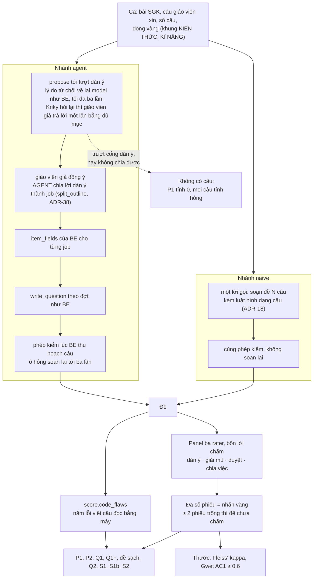

# Thiết kế chấm chất lượng nội dung

Tài liệu này giữ cách đo chất lượng thứ model viết ra. Hiện có một phần: **bench chất lượng ra đề**
(`tools/exam_bench`, plan `exam-quality-bench`). Prompt và lựa chọn model chưa viết ở đây; chúng vẫn
nằm trong code của `services/agent` và các plan đã đóng.

## Bench chất lượng ra đề

### Đo gì

Hai điểm giáo viên quyết định khi Kriky ra đề:

1. **Dàn ý có duyệt được không** -- trước khi câu nào được soạn (ADR-29).
2. **Đề lần đầu có phát hành được mà không sửa không** -- trước khi giáo viên chạm vào câu nào.

Bench không đo độ khó, độ phân biệt câu hay lỗi thật của học sinh: những số ấy cần bài làm thật.

### Bộ ca và vàng

`tools/exam_bench/cases.json`: mỗi ca là một bài SGK Kết nối tri thức (lớp 6, 8, 10, 12; số học, đại
số, hình học, thống kê, giải tích; một ca phủ hai bài), một câu giáo viên xin đề, số câu xin. **Vàng**
là khung *KIẾN THỨC, KĨ NĂNG* sách in đầu mỗi bài: yêu cầu cần đạt do sách viết sẵn, không phải tiêu
chí tự nghĩ. SGK trong `data/` là ảnh scan, nên khung ấy được chép tay từ ảnh trang, một lần. Câu
giáo viên của ca chịu luật *câu đo không nằm trong prompt* (`tools/tests/test_propose_bench.py`).

### Hai nhánh

| Nhánh | Đường đi | Ghi chú |
| --- | --- | --- |
| `agent` | Đúng đường của Kriky, vẽ ở sơ đồ dưới | Cùng model và cấu hình trong `.env`. Trước ADR-38 (pilot `run-130`): dàn ý có mục cấu trúc, BE chia mục thành ô (`place_items`) |
| `naive` | Một lời gọi tới cùng model: *"soạn đề N câu…"* kèm luật hình dạng câu (ADR-18) | Cùng phép kiểm, không soạn lại; đường so để biết agent thêm được gì |

Câu hỏi sơ đồ trả lời: *một ca đi qua bench thế nào, từ câu giáo viên xin tới các chỉ số?*



### Panel rater và nhãn vàng

Ba rater: `claude-opus-5-5`, `claude-sonnet-5-5`, `claude-opus-4-8` -- khác hạng và khác thế hệ, không
rater nào là model sinh đề. **Đa số phiếu là nhãn vàng.** Mọi tiêu chí là câu có/không kèm lý do. Bốn
loại lời chấm:

| Lời chấm | Rater thấy | Tiêu chí |
| --- | --- | --- |
| Dàn ý | Yêu cầu, dòng vàng, các mục (từ ADR-38: các job Kriky chia) | Mục kiểm dòng vàng nào; D1 cụ thể, D2 công thức đúng, D3 vừa khối và phạm vi, D4 không trùng mục khác |
| Giải mù | Đề và phương án, **không** đáp án, lỗi ghi kèm hay lời giải | Từng phương án có đúng không |
| Duyệt | Đề, đáp án khoá, lỗi ghi kèm từng phương án nhiễu, mục dàn ý (từ ADR-38: job của câu) | Bảy loại lỗi nặng; câu có bám mục; từng phương án nhiễu có tái tạo được bằng đúng lỗi ghi kèm |
| Chia việc | Lời dàn ý giáo viên đã đọc, các job AGENT chia ra | Mỗi job: trung thành với dàn ý, tả đúng một câu, khác câu anh em; cả đề: dàn ý phủ đủ, đúng số câu |

Năm lỗi viết câu đọc được bằng máy -- hai phương án trùng chữ, phương án *"tất cả các phương án
trên"*, đáp án dài bất thường, đề có hai câu hỏi, đề chép lại phương án -- do code bắt
(`score.code_flaws`), không giao rater.

### Chỉ số

| Chỉ số | Định nghĩa |
| --- | --- |
| **P1 độ phủ** | Tỉ lệ dòng vàng được ít nhất một mục phủ, mẫu số `min(số câu, số dòng vàng)`; dàn ý trượt cổng tính 0 |
| **P2 mục duyệt được nguyên** | Mục qua cả D1–D4 |
| **Q1 câu dùng được nguyên** | Giải mù ra đúng khoá ∧ đúng một phương án đúng ∧ không lỗi nặng ∧ không lỗi code, **trên mọi câu được xin** -- đề trượt cổng, ô hỏng, câu không trả đều là câu không dùng được. Cùng phép cho hai nhánh |
| Q1+ | Q1 cộng *bám mục dàn ý*, chỉ nhánh `agent` |
| Đề sạch | Đề đủ số câu xin và mọi câu dùng được nguyên |
| **Q2 phương án nhiễu trung thực** | Phương án nhiễu mà lỗi ghi kèm tái tạo đúng nó, chỉ trên câu có khoá đúng |
| S1 job trung thành | Job khớp lời dàn ý, không thêm, không đổi (ADR-38) |
| S1b một câu, khác anh em | Job tả đúng một câu và khác các job cùng phần |
| S2 dàn ý phủ đủ | Mọi phần của dàn ý có job, đúng số câu |

Từ ADR-38, P1 và P2 chấm **các job** AGENT chia, vì dàn ý không còn mục có cấu trúc: P1 là độ phủ
khung yêu cầu cần đạt của các câu sẽ soạn, P2 là job duyệt được nguyên. Hai số này không so thẳng với
P1, P2 của pilot `run-130` (mục do Kriky viết cùng dàn ý).

Lời chấm có từ hai phiếu trống trở lên (API hỏng, hết credit) thì đề tính là **chưa chấm**, không phải
đề có câu hỏng: lượt `agent-split-bench` hết credit giữa chừng, và bảy đề phiếu trống từng kéo Q1 xuống
−26 điểm giả.

### Thước có tin được không

Mỗi tiêu chí báo Fleiss' kappa, **Gwet AC1** và đồng thuận thô trên các hàng đủ ba phiếu. Kappa sụp
khi gần như mọi phiếu cùng một phía (nghịch lý tỉ lệ): tiêu chí 95% *có* với ba rater gần như nhất
trí vẫn ra kappa thấp hay âm. AC1 không sụp như vậy, nên **AC1 ≥ 0,6 là ngưỡng tin**; kappa đọc kèm để
thấy cặp rater nào lệch. Lời chấm được cache theo hash của mọi thứ rater đọc (prompt, schema, tham số
gọi, nội dung), nên đổi cách gộp phiếu thì gộp lại không tốn tiền (`--from-run`).

### Kết quả pilot (12/11/2026, `data/results/run-130`)

8 ca; nhánh `agent` 2 lượt mỗi ca (106 câu xin), `naive` 1 lượt (53 câu xin, 49 câu thu được sau cổng
ADR-18 và một câu không trả). Model sinh đề `claude-haiku-5-5`, thinking tắt, effort thấp, ở **cả
hai** nhánh. Chi phí panel 15,29 USD (cộng 0,02 USD Haiku của nhánh `naive`). Số liệu được một
subagent tính lại độc lập từ `ratings.jsonl`: khớp.

| Chỉ số | `agent` | `naive` |
| --- | --- | --- |
| P1 độ phủ | 0,80 | -- |
| P2 mục duyệt được nguyên | 82% (47/57) | -- |
| Q1 câu dùng được nguyên | 63% (67/106); 65% (69/106) sau khi sửa luật `phuong-an-trung` | 70% (37/53) |
| Đề sạch | 2/16 | 2/8 |
| Q2 phương án nhiễu trung thực | 71% (199/281) | 78% (107/138) |

Câu không dùng được, theo nguyên nhân (một câu có thể có nhiều): `agent` khoá sai 17, nhiều đáp án
đúng 10, lỗi nặng 19, lỗi code 9; `naive` khoá sai 3, nhiều đáp án đúng 3, lỗi nặng 7, lỗi code 5, ô
hỏng ở cổng 3, một câu không trả. 12/19 câu *lỗi nặng* của `agent` đã trượt vì khoá sai hay nhiều
đáp án đúng; câu **chỉ** trượt vì lỗi nặng: `agent` 7, `naive` 3.

Đồng thuận panel: AC1 ≥ 0,75 ở mọi tiêu chí -- giải mù 0,97, độ phủ 0,89, lỗi nặng 0,78, phương án
nhiễu 0,75. Kappa thấp ở D2, D4, *bám mục* và từng mã lỗi rơi vào tiêu chí ≥ 95% một phía; ở D1,
Opus 4.8 gần như luôn chấm *có*. **Lỗi nặng (κ 0,50) và phương án nhiễu (κ 0,62) thì không lệch một
phía**: đó là bất đồng thật ở mức vừa -- lỗi nặng là thành phần kém chắc nhất của Q1; hai câu bị chê
vì ba lý do khác nhau của ba rater. Cặp Sonnet 5.5 – Opus 4.8 lệch nhất ở *lỗi nặng* (κ 0,33).

Đọc tay (subagent tự giải 14/17 câu `agent` panel đánh khoá sai): panel đúng cả 14.

Đọc kết quả:

- **Dàn ý phần lớn duyệt được** (P1 0,80; P2 82%), nhưng 3/16 dàn ý chỉ phủ một phần ba khung yêu cầu
  cần đạt; chưa có đường so (nhánh `naive` không có dàn ý).
- **Đề lần đầu chưa hơn một lời gọi thẳng.** Q1 −7 điểm không có ý nghĩa thống kê (Fisher p ≈ 0,48;
  bootstrap theo ca [−24,5; +9,1] điểm), nhưng hai lượt `agent` (34 và 33 trên 53 câu) đều dưới
  `naive` (37/53).
- **Khoá sai nghiêng về `agent`**: 16% (17/106) với 6% (3/53), cùng chiều ở 6/7 ca không hoà; Fisher
  p ≈ 0,08, `naive` chỉ một lượt, 9/17 câu đến từ hai ca. Cần thêm lượt `naive` và thêm ca trước khi
  khẳng định. Hai nhánh cùng tắt thinking, nên đó không phải lời giải thích; giả thuyết là job soạn
  một câu không thấy cả đề. Một dấu hiệu đáng thử: ở 16/17 câu ấy, chính lời giải (`methods`) của job
  đã tự mâu thuẫn với khoá (*"kết quả là 15"*, *"cần đối chiếu lại"*).
- **Nhiều đáp án đúng** (10 câu `agent`) là gốc của phần lớn phiếu *hai phương án tương đương*: danh
  mục lỗi nặng không có mã cho trường hợp ấy, nên rater dồn vào đó; đọc tay 11 câu đa số gắn mã này,
  chỉ 3 câu có hai phương án tương đương thật.
- Đây là thước của một pilot: 8 ca, hai lượt `agent`, một lượt `naive`.
- **Sửa thước sau pilot** (plan `agent-split-bench`): luật `phuong-an-trung` bắt nhầm `6` với
  `\{6\}` (tập khác phần tử -- phương án nhiễu chính đáng của bài tập hợp). Cả ba lần bắt ở
  `run-130` là bắt nhầm, đều ở `agent`, ca `tap-hop-6`; luật nay giữ ngoặc nhọn thoát. Q1 của
  `agent` thành 69/106 (65%).

### Nhánh `agent-md` (plan `agent-split-bench`, 13/11/2026, dừng giữa chừng)

Thử hướng *agent tự chia job*: trên **cùng** 16 lượt dàn ý của `run-130`, agent chỉ đọc lời Markdown,
tự viết lời dặn từng câu, rồi soạn và thu như nhánh `agent`. Lượt chạy (`run-134`) hết credit API khi
mới chấm đủ 9/16 đề:

- Q1 so cặp với `agent` trên cùng dàn ý: +1,8 điểm, khoảng 95% bootstrap theo ca [−3,1; +10,8], 9
  cặp -- chưa thấy hơn, cũng không kém.
- S1 job trung thành 49/50 trên 4 ca đầu; số job đúng 16/16 đề.
- Hai lượt khói trên cùng một dàn ý cho +50 rồi +0 điểm: nhiễu của bước soạn trên một ca rất lớn.

Người dùng thấy chất lượng đủ để đưa hướng này vào hệ thống thật (ADR-38) và không chạy nốt; bốn ca
chưa chấm gồm `don-dieu-cuc-tri-12`, nơi khoá sai dồn nhiều nhất. Từ ADR-38 nhánh `agent` **là** hướng
này, nên `agent-md` đã gỡ khỏi bench.

### Giới hạn đã biết

- Rater cùng họ Claude với model sinh đề. Tiêu chí nặng nhất (khoá đúng) chấm bằng giải mù, không
  bằng cảm nhận, nên ít chịu thiên vị ấy hơn -- phần đọc tay ủng hộ điều này.
- Không có nhãn tay đối chiếu với panel: nhãn vàng là đa số của ba LLM (người dùng chốt).
- 8 ca; `naive` một lượt so với hai lượt `agent`.
- Danh mục lỗi nặng thiếu mã *nhiều đáp án đúng*; thêm mã là chấm lại (đổi `PROMPT_VERSION`).
- Vàng là khung yêu cầu cần đạt, hẹp hơn nội dung bài: mục kiểm nội dung trong bài mà ngoài khung bị
  đếm *ngoài khung*.
- Không ca nào đính kèm tài liệu: đường đọc sách cần Mongo.
- Chi phí token Haiku của nhánh `agent` không được đếm (gọi qua LangChain).
- Bench đo `claude-haiku-5-5` (kiểm `LLM_MODEL`); `.env` dev từ 13/11/2026 là `gpt-4o-mini`, nên
  chạy bench phải đổi model trước -- và hỏi người dùng.

### Chạy

```bash
PYTHONPATH=tools python -X utf8 -m exam_bench.run --label <nhãn> --agent-runs 2 --naive-runs 1 --cap 40
PYTHONPATH=tools python -X utf8 -m exam_bench.run --label <nhãn> --from-run data/results/run-<n>/exam-<nhãn>
```

Bench gọi model thật và tốn tiền: hỏi người dùng trước mỗi lượt chạy. Nhãn không được mang mã task
(`task_code_in`).
